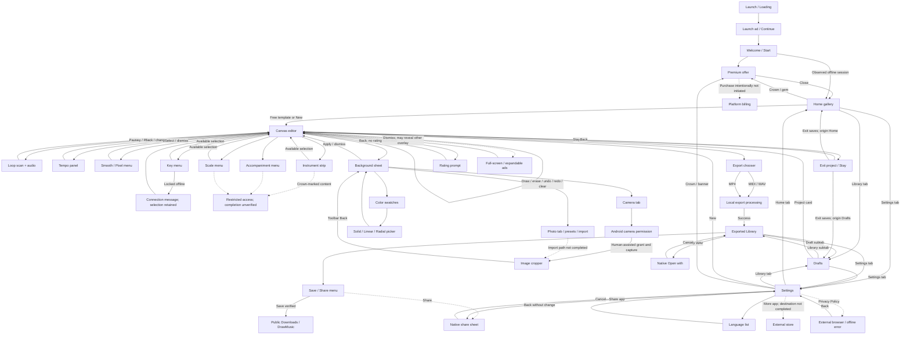

# ScribbleSong — Flutter Product Requirements Document

**Working brand:** ScribbleSong (original working name; final naming decision pending).  
**Platforms:** Android and iOS using Flutter / Dart.  
**Research reference:** Draw Music: Sketch to Sound, `com.banix.drawsound.drawmusic`, Android 2.0 (11).  
**Research date:** 23 October 2026, Asia/Dubai.  
**Status:** Product and engineering specification based on black-box research. No Flutter application has been implemented.

## Evidence conventions and reading guide

- **Observed (O):** directly captured screen, visible interaction, Android metadata, recorded audio, or explicitly identified human assistance.
- **Inferred (I):** a plausible explanation of observed behavior; never a claim about proprietary implementation.
- **Proposed (P):** a requirement or design choice for the new application. Unless explicitly labeled O or I, requirements in this PRD are P.
- **Unknown (U):** not established in this session, inaccessible, interrupted, or requiring a technical spike.

Use the [screen catalog](research/SCREEN-CATALOG.md), [research log](research/RESEARCH-LOG.md), [measurement notes](research/INTERACTION-MEASUREMENTS.md), [source register](research/SOURCE-REGISTER.md), and experiment JSON/video evidence alongside this document. The pasted request ends after “Feature-first” in section 7; no missing continuation was assumed. Raw source-app screenshots are research references only. Source branding, character art, template drawings, icons and audio must not ship in ScribbleSong.

A complete specification does not imply that all behavior of the paid reference application was observable. Premium access, purchases, physical haptics, first-install order and several failure cases remain explicitly unverified. The new product's behavior in these cases is specified below.

## 1. Product overview

### 1.1 Vision, problem and value

Make musical creation as approachable as doodling: draw a shape, press Play, watch a cursor turn its geometry into a short, harmonious loop, change the instrument, and keep or share the result. People who cannot read notation should still understand the relationship between the picture and the sound.

Conventional music editors expose tracks, notes and timelines before a novice can make something satisfying. Ordinary drawing apps do not connect a mark to sound. ScribbleSong joins these actions in a playful, private, offline-capable creative toy with predictable results and recoverable edits.

The primary audience is casual creators and music-curious beginners. A secondary audience is parents or educators making supervised creative activities. A child-directed commercial release is not assumed by this PRD; audience positioning, analytics and monetization need an explicit product decision before launch.

### 1.2 Core experience

1. Open an original template or a blank canvas from a two-column gallery.
2. Draw with a selected instrument; each instrument has an associated visual color and icon.
3. Press Play. A left-to-right cursor scans the canvas; higher marks produce higher pitches and wider marks occupy more musical time.
4. Pause, erase, undo, change tempo/key/scale or add another instrument.
5. Leave safely with a saved editable project, or export an image/audio/video according to supported release scope.

### 1.3 Product differentiation

Preserve the reference's warm paper-like background, rounded controls, pastel instrument colors, visual scanning and inviting template cards. Improve interruption handling, explain musical mapping, give every icon an accessible name, keep controls reachable, and make saving/export outcomes explicit. Use a new mascot concept, commissioned icon family, new title treatment, original editable templates and licensed or commissioned instrument samples.

### 1.4 Scope and release priorities

**P0 / MVP:** original home gallery; blank/template canvas; smooth strokes; instrument-linked colors with at least three original sounds; eraser; undo/redo/reset; deterministic loop generation; play/pause/replay; tempo; at least C major pentatonic and minor pentatonic; local editable projects; recovery after interruption; MIDI, WAV and MP4 export; native share sheet; settings/help; accessible light theme. No account or server is required for creation, saving or audio playback.

**P1:** pixel style; more instruments/scales/keys; accompaniment; photo/camera backgrounds and cropping; PNG export; premium entitlements and optional monetization after core quality gates. MIDI/WAV/MP4 are parity requirements; video feasibility must pass its native export spike before implementation scope is committed.

**P2:** expressive velocity mapping, stylus-specific support, dark theme, tablet workspaces, cloud backup/collaboration and advanced composition controls. These are differentiation ideas, not observed reference features.

### 1.5 Success metrics

Targets are proposed, not measured competitor metrics. Instrument only consented, content-free events; never upload stroke coordinates, photographs or audio by default.

| Metric | Definition | Initial target |
|---|---|---|
| First creation success | New users who add a stroke and start playback / new users who enter editor | ≥80% in moderated usability sessions |
| Time to first sound | Editor entry to first successful Play, excluding intentional idle time | Median ≤30 seconds |
| Save reliability | Successfully committed local revisions / attempted commits | ≥99.9% in release QA and eligible telemetry |
| Export completion | Successful artifact creation / export attempts, excluding user cancellations | ≥98% |
| Warm playback response | Tap-to-audible onset on specified physical speaker route | p95 ≤100 ms; validate, do not assume package guarantee |
| Drawing performance | Frame times during a 10k-point reference scene | p95 ≤16.7 ms on the designated 60 Hz baseline device |
| Loop synchronization | Visual cursor versus rendered audio event schedule | ≤1 display frame in steady playback on baseline devices |
| Usability | Participants can undo and find saved work without help | ≥90% |

## 2. Competitive application analysis

### 2.1 Evidence environment

O: One authorized USB Android device was found: Nothing A059P / Asteroids, Android 16 / API 36, portrait 1080 × 2392 px, density 420 dpi, font scale 1.0. Logical display size is approximately 411.4 × 911.2 dp using a verified 2.625 px/dp scale. The display reports a 120 Hz mode; this does not measure application FPS. The installed app reports versionName 2.0 / versionCode 11, minSdk 23, targetSdk 36.

Existing application data was preserved. No decompilation, root, asset extraction, purchase, intentional installation from an ad, paywall bypass or source-code access was used. A first captured launch was already an advertisement. A later normal restart exposed a loading splash, ad continuation, welcome and premium offer. This is not proof of clean-install onboarding order.

### 2.2 Observed product structure

O: Home is a vertically scrolling, two-column template gallery. Its header has an illustrated wordmark and crown. A large bottom capsule contains Home, Library and Setting destinations; a separate teal circular plus button creates a project. Visible template examples include Abstract, Bear, Beat 1–3, Bird, Bird 2 and Boat; later gallery positions include Boy/Boy 2 and Bunny/Bunny 2, with premium gem badges on some cards. These names describe reference content, not a content plan for the new application.

O: The editor has an upper row for Back, tempo minus/value/plus, background and Export; a second row for brush, eraser, smooth/pixel style, accompaniment, key, scale and reset; a large rounded cream canvas; undo/redo and Play below; and a horizontally scrolling instrument strip. Default settings shown were 120 BPM, C, Major pentatonic, Soft Key and smooth drawing. The complete scrolled instrument strip exposed 13 labels: Soft Key, Marimba, Bells, Warm Synth, Pluck, Flute, Strings, Chime, Bass, 8 bit, Electronic Bass, Guitar and Saxophone. Soft Key, Marimba and Bells were exercised; playback for the locked presets remains unverified.

O: First-use contextual tips highlight tempo, drawing style, accompaniment, key and scale. The source uses a dimmed background, spotlight rectangle, dotted connector and rounded white explanation bubble. Red dots advertise unexplored controls and disappear on some visited controls.

O: Key choices span C through B. C, C#, D and D# appeared without lock badges; E through B displayed locks. Scales shown were Major pentatonic, Minor pentatonic, Major, Minor, Harmonic minor, Dorian, Phrygian, Lydian, Mixolydian, Blues and Chromatic; later options displayed locks. A lock badge is evidence of visual gating, not proof of a completed entitlement flow.

O: Background editing has Color, Photo and Camera tabs, preset swatches, custom solid/linear/radial color modes, opacity and Apply. The photo row shows an import tile and built-in backgrounds. The camera path requests Android permission. The human user granted permission and took a photograph, after which a cropper with handles, grid and transform controls appeared. Denial behavior was not established.

### 2.3 Journey, strengths and weaknesses

O: The observed creation journey is Gallery → Plus → Canvas → Draw → Play → Edit. Back can show “Exit the project” with Exit and Stay, promising to save before leaving. A rating prompt can interrupt the editor; Back dismisses it. A full-screen premium screen can be closed with X.

Strengths: immediate visual invitation; friendly color grouping; a central canvas; a clear moving playback scan; musical key/scale constraints; editable template entry points; and several ways to personalize the background.

Observed friction: repeated full-screen and expandable ads; lower ads cover playback/instrument controls despite those controls remaining in underlying accessibility XML; loading overlays can persist through Back; many icon controls lack accessible descriptions; a long premium disclosure extends beyond a single captured screen; and rating requests interrupt the creative flow. Some ad dismissal attempts unexpectedly opened a store/browser; the exact SDK cause is unknown. Contaminated experimental recordings were excluded.

### 2.4 Monetization evidence

O: Launch video ad labeled “Ad 1 of 2”; app-open advertisement with “Continue to app”; full-screen native advertising over editor; expandable lower native/media ads; premium entry via crown; and gem/lock indicators were captured. Multiple ads could appear layered or be replaced during the session. No controlled frequency or trigger policy was established. Do not infer a fixed “every N taps” or timer rule.

O: The premium offer promotes instruments, templates, background music and an ad-free experience. It showed a weekly three-day trial with “FREE For today”, and a monthly offer of **39 AED/month** on this device/session. The actual recurring weekly price was not established. Selecting the monthly card changed the CTA to Continue and changed the supporting copy. No transaction was initiated or completed. Rewarded unlock execution and purchase restoration remain unverified unless separately noted in the final research addendum.

P: ScribbleSong MVP is an uninterrupted free creative session. Monetization is P1, with transparent prices from the store, no automatic paywall before first creation, no ad covering controls, and no purchase success inferred from UI selection. This is an intentional product improvement.

## 3. Feature requirements

Requirements below describe the **new product**. Every feature includes a user story, functional/interaction rules, testable acceptance conditions, exceptions and priority. Screen references in section 4 supply the corresponding visual/state specification.

### F01 — Entry, onboarding and help · P0

**Story:** As a beginner, I can reach a canvas and learn the controls while creating. Show a lightweight brand/loading state only while essential local initialization runs. Welcome has a single Start action. Offer skippable contextual tips for Draw, Play, instrument, tempo, key and scale; store completion flags and provide Help → Replay tips. Do not block creation on network, ads or analytics.

**Acceptance:** Fresh local state reaches usable home with no runtime permission request. Start works offline. Each tip has Next/Skip or an equivalent clearly named dismiss action, returns focus to its control and does not pass its dismissal tap through to the canvas. Reloading retains completed tips. **Edges:** initialization failure offers Retry and usable error detail; backgrounding mid-tip does not reset the project.

### F02 — Template gallery and navigation · P0

**Story:** As a casual creator, I can start from an appealing example or a blank page. Provide Home, Library and Settings in a persistent rounded bottom navigation component, with selected icon + label; keep New separate and prominent. Display original template thumbnail, title and optional locked badge in a two-column phone grid. Selecting a free template creates an editable project copy.

**Acceptance:** New opens an empty editor; a template opens an independent copy whose edits cannot change the catalog original. Returning restores gallery scroll and selected tab. At 320 dp width and 200% text scale, card titles and navigation remain operable. **Edges:** unavailable thumbnail uses a neutral original placeholder; empty catalog offers New; locked selection explains access before navigating to an offer.

### F03 — Smooth drawing and input capture · P0

**Story:** As a creator, I draw a mark that becomes part of my loop. Capture one active pointer in normalized canvas coordinates; round caps and joins; selected instrument controls future stroke color/timbre. Pointer-down creates a visible dot; movement extends a stroke; pointer-up commits one undoable operation. Retain raw timing for future use while default playback follows geometry.

**Acceptance:** Tap produces a dot; horizontal, vertical, circle and zigzag strokes remain continuous; leaving/reentering the canvas does not draw across controls; cancellation commits the visible valid segment once. Drawing while paused produces no music by default. **Edges:** second pointer is ignored for drawing; NaN/out-of-range input is rejected or clamped; app suspension ends the active stroke; exceeding point limits simplifies older geometry without silent deletion.

### F04 — Instrument/color selection · P0

**Story:** As a creator, I can combine recognizable sounds by changing the drawing instrument. Ship at least three original/licensed sample sets, with coordinated pastel tiles, a unique icon and a visible name or accessible label. Color is the instrument identity in MVP; an arbitrary independent stroke-color picker is not required for parity. Selecting a tile affects subsequent strokes; earlier strokes retain their instrument.

**Acceptance:** A selected tile has a high-contrast ring and non-color indicator. Draw with A then B: both colors remain, and playback uses the corresponding sounds. Reopening a project preserves assignments. **Edges:** unavailable instrument uses an explicit substitute and preserves original metadata; failed sample loading has Retry; a locked tile preserves current selection and opens an entitlement explanation.

### F05 — Eraser · P0

**Story:** As a creator, I can remove a local mistake without clearing the piece. Select eraser mode with a persistent highlight. Use a proposed 12 dp hit radius, shown by a transient cursor. Split intersected stroke segments and remove their corresponding musical contribution. One eraser gesture is one undo step.

**Acceptance:** Erasing the middle of a line creates a visible and audible gap; Undo restores the full line; erasing empty space creates no history entry. **Edges:** intersection calculations handle single-point dots and crossing strokes; eraser never affects the background image; audio is regenerated for the next playback revision.

### F06 — Undo, redo and clear · P0

**Story:** As a creator, I can experiment without losing work. Enable history for stroke, eraser, background, instrument reassignment if later added, and global musical edits. A new edit after Undo clears Redo. Reset/Clear removes all strokes with a reversible operation and an explicit confirmation for nonempty artwork; preserve project identity/background unless the user selects Reset all.

**Acceptance:** Undo/Redo update both image and generated score, and visually disable at history ends. Clear can be undone. Proposed bounds: retain 100 commands or 20 MB of history, whichever comes first, preserving the current document. **Edges:** repeated taps are serialized; empty clear is a no-op; export does not create an edit-history entry.

### F07 — Geometric music generation · P0

**Story:** As a beginner, I can predict how a shape sounds. Map horizontal position to loop time and vertical position to a pitch constrained by key/scale. A vertical stroke can create several simultaneous pitches; a curved shape can create multiple pitch paths. Use the practical algorithm in section 6, not a claim about the reference's internals.

**Acceptance:** The same document and engine version produce the same sorted score. A horizontal line has one pitch band; moving it upward increases pitch; moving it right delays onset; shortening it reduces its occupied time. Reversing touch order or drawing the same geometry at different speeds does not change default score within resampling tolerance. **Edges:** zero-length strokes create short notes; overlaps deduplicate equivalent events; polyphony and event budgets prevent unbounded work.

### F08 — Play, pause, loop and replay · P0

**Story:** As a creator, I can hear and watch the drawing repeatedly. Play compiles a document snapshot, prepares sources, then starts a looping audio schedule and scan cursor from time zero. Pause fades active voices and stores position. Resume continues from that position; Replay is explicitly available to restart from zero. Define this behavior consistently; source resume semantics remain unverified.

**Acceptance:** Exactly one transport session is active. Pause leaves a stable cursor; Replay returns it to the left edge. Empty Play is disabled with “Draw something to hear it.” No note is generated during pause. UI position derives from the audio clock and handles loop wrap. **Edges:** drawing edits during playback are accepted visually but take effect at the next loop boundary with a small “Updates next loop” indicator; export uses a stable snapshot; interruption stops or pauses safely.

### F09 — Tempo · P0

**Story:** As a creator, I can make the loop slower or faster. Provide minus/value/plus; tapping the value opens a tempo panel. Use the observed 60–200 BPM range and one-BPM button step. Tapping the value opens a slider panel; exact integer entry can be a P1 accessibility enhancement. Default 120. Long press repeats after 400 ms at 100 ms intervals, with range limits; these timings are proposed, not measured source behavior.

**Acceptance:** Invalid/non-numeric input cannot commit; out-of-range values show bounds; changing tempo preserves pitch and artwork geometry. While playing, apply at the next beat without a stuck voice or duplicated start. **Edges:** rapid input is coalesced; min/max buttons are disabled; display localization never changes stored numeric values.

### F10 — Key and scale · P0 core / P1 expanded catalog

**Story:** As a beginner, I can select a mood without managing individual notes. MVP includes C major pentatonic and C minor pentatonic; P1 exposes all 12 root keys and the observed families plus original descriptions. A compact icon may represent the current scale, but an accessible label and readable selected value must be available.

**Acceptance:** Selecting a key/scale updates all derived notes while retaining drawing coordinates. The selected item is indicated by check + contrast, not color alone. Leaving the sheet without selection leaves settings unchanged. **Edges:** unavailable premium choice opens access explanation without applying; unsupported legacy scale uses a labeled fallback and retains the original ID in saved data.

### F11 — Pixel drawing style · P1

**Story:** As a creator, I can switch between fluid lines and a block-like look. Provide Smooth and Pixel choices in an anchored two-item menu. Pixel style quantizes visual geometry to a proposed 32-column grid while retaining editable normalized source strokes. Document whether style affects score; initial proposal changes visual treatment only, keeping the score deterministic from the original geometry.

**Acceptance:** Switching style preserves the composition and history; switching back restores smooth geometry without destructive conversion. **Edges:** very short strokes remain visible; grid cells scale with canvas size; a screen reader announces the selected style.

### F12 — Accompaniment and mixing · P1

**Story:** As a creator, I can give my drawing a rhythm. Offer independent Bass, Drum kit and Arpeggio switches, then advanced Kick/Snare/Clap/Hi-hat controls. All patterns are original and synchronized to the same beat clock. Provide mix level and mute; avoid double-triggering individual drums already enabled through Drum kit.

**Acceptance:** Enabling accompaniment starts at the next loop/beat boundary; disabling fades only its bus; the visual drawing does not change. Export includes exactly the selected layers. **Edges:** sparse drawings still yield a valid loop; no accompaniment is audible while paused; tempo changes update patterns without drift.

### F13 — Canvas backgrounds · P0 solid / P1 photos and gradients

**Story:** As a creator, I can personalize my page without changing its music. Use a bottom sheet with Color, Photo and Camera tabs. Solid defaults and opacity are P0. P1 adds original linear/radial presets, system photo selection, camera capture and a cropper. Preview changes transactionally and commit only on Apply; cancel restores the earlier background.

**Acceptance:** Opacity is 0–100% with a readable value. Background changes never generate notes. Permission denial/cancel returns to the sheet with artwork intact; photo assets are copied to app-private storage on commit. **Edges:** rotated/HEIC/very large images are decoded safely; missing asset offers Replace/Remove; app death during external picking is recoverable.

### F14 — Save, exit and recovery · P0

**Story:** As a creator, I can leave and find my work later. Autosave immutable committed revisions after a proposed 500 ms idle debounce and on lifecycle transition. Back pauses playback, completes the current stroke and shows Save and leave / Stay only when a commit is pending or an error needs resolution. Never promise a save before it succeeds.

**Acceptance:** Leaving and reopening retains strokes, instruments, key, scale, tempo, background and title. A completed save survives force-stop. A failed save blocks a misleading success transition and offers Retry or Export recovery. **Edges:** kill during write restores last complete revision; stale asynchronous saves cannot overwrite newer edits; low disk space leaves the previous revision intact.

### F15 — Library management · P0

**Story:** As a returning creator, I can find, open, rename and delete my creations. Show thumbnails and titles sorted by updated time, plus clear empty and load-error states. Overflow provides Rename, Duplicate, Share/Export and Delete. Delete requires confirmation and offers a short undo window through a soft-delete record.

**Acceptance:** Renaming validates 1–60 trimmed characters; cancel does not change metadata. Opening a card loads the editable document. Duplicating creates a new ID and independent asset references. **Edges:** corrupt project is isolated with Recover/Delete options; long/RTL titles wrap or truncate accessibly; deleting one project does not remove assets still used by another.

### F16 — PNG export · P1 (original addition)

**Story:** As a creator, I can keep the visual result. Export a clean image from document coordinates, including the chosen background by default, excluding app controls, cursor, ads and source-app branding. Proposed default canvas output is 1080 px wide with stored aspect ratio; expose transparent background as an option when applicable.

**Acceptance:** File decodes, dimensions match the displayed choice and content is not cropped. Export never changes editable project data. **Edges:** empty image export prompts confirmation; memory limits use tiled or bounded rendering; a failed write leaves no artifact marked complete.

### F17 — WAV export · P0

**Story:** As a creator, I can use the sound outside the app. Render one or more whole loops from the deterministic score into a 44.1 kHz mono 16-bit PCM WAV for source-format parity; offer 48 kHz stereo as a later option. Default is one eight-beat loop with a short bounded effect tail; UI displays duration and estimated size before export. The source export in this session was independently verified as 44.1 kHz mono PCM16, ~5.23 seconds for a four-second loop plus tail. Exact tail policy remains a proposed engine parameter.

**Acceptance:** Header/data length are valid, exported pitch/tempo/instruments match preview and output contains no system/ad/microphone audio. Progress, Cancel, Error/Retry and Success are explicit. **Edges:** interrupted rendering is cancelable; temp files clean up; clipping is prevented; missing assets produce a clear error, not silent substitution in a purportedly final export.

### F18 — MP4 export · P0

**Story:** As a creator, I can share the animated relationship between drawing and music. Produce H.264 video with AAC audio, deterministic cursor motion and optional original branding; no screen recording or microphone permission is needed for document rendering. Preserve the document/canvas aspect ratio, initially targeting 1080 px width at 30 FPS, with a 60 FPS option after profiling; use exact loop-aligned duration and a bounded tail. The source test produced a canvas-only 1136 × 1440, 60 FPS H.264/AAC file without a system recording consent prompt.

**Acceptance:** Audio/video timestamps align within one output frame; the file is playable on both target platforms; cancel keeps the editable project; export progress survives a transient UI rebuild. **Edges:** codec unavailable offers lower resolution; backgrounding behavior is explicit; low storage stops cleanly; very long jobs require confirmation.

### F19 — Native sharing · P0

**Story:** As a creator, I can send an exported artifact through my chosen app. Finish rendering before opening the OS share sheet; provide file, MIME type and meaningful filename. A canceled sheet is cancellation, not export failure or proof of delivery. Keep the file available until the receiving app has had a reasonable opportunity to read it.

**Acceptance:** Native sheets open with MIDI/WAV/MP4 attachments in P0 and PNG in P1. No recipient is preselected or automatically messaged. **Edges:** unsupported receiving apps are outside the app's delivery guarantee; unavailable share result is not reported as confirmed sent; iPad uses a valid popover anchor.

### F20 — Settings, accessibility and help · P0

**Story:** As a user, I can understand and control the app. Provide sound level, optional haptics, reduced motion/system preference, Help, replay tutorial, privacy information and app version. P1 adds Manage premium/Restore purchases if monetization ships. Keep settings separate from stroke tools.

**Acceptance:** Changes persist across restart; disabling UI sound does not silently mute exported music; accessibility labels cover every icon and selection. Text at 200% remains usable; the canvas offers an alternative note/event summary and template/playback path for users who cannot draw precisely. **Edges:** no audio device or muted system volume gets a nonblocking explanation; help works offline.

### F21 — Premium and entitlement handling · P1

**Story:** As a user, I can understand which optional content requires payment and what it costs. A dismissible original premium screen explains exact benefits and shows localized store-derived recurring price, duration, trial eligibility and renewal terms. Selecting a plan changes only selection; purchase requires the store flow. Restore and manage subscription are clearly available.

**Acceptance:** Pending/canceled/failed purchase keeps access unchanged; only verified entitlement grants access. Offline state preserves a valid cached entitlement within a defined policy and never invents a new purchase. **Edges:** store unavailable, expired trial, family sharing where supported, refund/revocation and account changes are covered by store sandbox QA. Actual purchases were not tested in competitor research.

### F22 — Ads and rating requests · P1 optional

**Story:** As a creator, I keep control of my work while using a free app. If ads ship, reserve a layout area that cannot overlap tools; never show one during a stroke, playback, recording/export or unsaved navigation. Loading must time out and continue the free session. Rewarded ads, if chosen, require a clear opt-in explanation, show reward eligibility, and grant only after the SDK's verified reward callback.

**Acceptance:** Ad failure has no effect on drawing or saving. Close/Back returns to the same document state without click-through to content. Premium suppresses eligible ads. Rating prompts appear only after a completed successful task, are dismissible, and obey a proposed 30-day dismissal cooldown. **Edges:** no-fill, offline, consent unset, SDK activity recreation and reward callback duplication are idempotent. No rating is submitted automatically.

### F23 — Lifecycle, errors and offline operation · P0

**Story:** As a creator, I do not lose my piece when interrupted. Model app lifecycle and transport separately. Pause audio on inactive/background or audio interruption; save the last complete edit; restore to a paused editor. Core assets and templates are bundled. Network outages affect only optional store/ad/content services.

**Acceptance:** Incoming audio interruption, headphone removal, force-stop recovery, no network, low storage and corrupt-file scenarios have recoverable states. Error messages state the failed action and Retry/Cancel without exposing stack traces. **Edges:** one active engine session; export jobs and save revisions have cancellation/version tokens; process recreation cannot repeat a purchase/reward or overwrite a newer revision.

### F24 — MIDI export · P0

**Story:** As a music-curious creator, I can use the generated notes in another music tool. Export a Standard MIDI File with tempo, note-on/off events, velocities and documented program/channel mapping. Clearly explain that MIDI contains notes and instrument instructions, and may sound different in another player. Editable project data remains a separate local format.

**Acceptance:** An independent parser reads the file; note timing matches the score; every note-on has a note-off; same-tick note-offs precede repeated note-ons; the end-of-track event follows the loop duration. Program mappings are original product decisions and versioned. **Edges:** overlapping same-pitch events are resolved predictably; percussion uses its designated channel; recipients without MIDI support get a normal OS error rather than a claimed delivery. The source two-line export was verified as SMF format 0, one track, 480 ticks/quarter and a tempo of 500,000 µs/quarter (120 BPM).

### F25 — Localization · P0 infrastructure / P1 additional locales

**Story:** As a user, I can use the interface in my preferred supported language. MVP ships English with localizable strings and locale-aware date/number formatting. Provide a scrollable language selector with native language names and an explicit Apply/check action; allow Back to cancel. Add tested translations in P1. Source-language inventory was English, French, Spanish, Italian, Korean, Japanese, Vietnamese, Hindi, Portuguese, Thai, Tagalog and Indonesian.

**Acceptance:** No user-facing string is embedded in an image except replaceable brand art. Locale changes preserve the project and selected tab. Layout passes long-string, non-Latin and RTL tests even before a particular RTL translation ships. **Edges:** an unsupported saved locale falls back to English; export file contents retain standard binary formats regardless of UI language.

## 4. Detailed screen specifications

### 4.1 Shared implementation contract

All new screens use the design tokens in section 5 and safe-area-aware layouts. Bounds marked **verified** come from the source accessibility hierarchy or raw image dimensions; styling dimensions marked **estimated** are measurements from pixels, not extracted original styles. The new-product implementation should use responsive constraints rather than literal 1080 px positions.

For every modal: focus enters the heading/first control, the background stops accepting touches, Back dismisses only the topmost modal unless a destructive decision is pending, and focus returns to its launching control. Proposed route transitions are 220 ms ease-out; sheet entry/exit 240/180 ms; menu fade/scale 140 ms; press feedback 90 ms. These are original timing specifications. Exact source transition durations, haptics and physical touch latency were not measured.

### S01 — Loading / launch

**Reference:** [006](research/screenshots/006-relaunch.png), [065](research/screenshots/065-recovery-launch.png). **Purpose/hierarchy:** safe-area brand region → original playful illustration → status text → progress track. O: source shows Loading Data… and an ad disclosure, with original artwork occupying most of the view. **Layout/style:** warm page background; estimated 24 dp side inset; thin rounded progress track near bottom. Do not reuse its illustration or clipped top wordmark.

**Interactions/state/navigation:** P: no tap required; initialization → Home/Welcome, error → Retry. No ad gate before local startup. **Animation:** brief original illustration motion, reduced-motion still alternative; determinate progress only when actual work is measurable. **Validation/edges:** never fake a percentage or loop forever after failure. **Acceptance:** usable offline entry; accessible loading announcement; retry preserves any existing project.

### S02 — Welcome

**Reference:** [008](research/screenshots/008-home.png), [067](research/screenshots/067-recovery-continue.png). **Purpose/hierarchy:** centered original app mark → title/tagline → large bottom Start. **Layout/style:** cream background, large intentional whitespace; verified source Start region [105,2149]–[975,2293] px (~331 × 55 dp), teal pill, bold white label in source.

**Interactions/state/navigation:** Start → Home; returning user can skip this route. O: source Start can reveal a premium offer before Home. P: premium is optional after the first successful creation. **Animation:** subtle mark entrance; no repeated motion behind a reading action. **Validation/edges:** one navigation per tap. **Acceptance:** Start remains visible above system bars at large text sizes; semantic label and focus order are clear.

### S03 — Premium / plan selection

**Reference:** [009](research/screenshots/009-start-result.png), [010](research/screenshots/010-premium-monthly.png), [068](research/screenshots/068-recovery-start.png). **Hierarchy:** dismiss X → original hero art/brand → benefits → plan cards → recurring-price explanation → CTA → terms/privacy/restore. O: source has mint sunburst art, weekly/monthly cards, mint selection border and a glossy yellow-to-pink CTA.

**Layout/style:** full-screen scrollable presentation; source close hit region ~39 dp square; plan/card radii estimated 20–28 dp; headline estimated 30–34 sp heavy. P: 48 dp close target; clear dark text; original character and icons; readable disclosures without tiny text. **Interactions:** selecting a plan updates selection/copy only; CTA enters store flow; X/Back returns to origin; Restore is independent. **State:** loading products, available, pending, purchased, canceled, failed, offline. **Animation:** restrained card selection, no urgency timer. **Validation/acceptance:** store-derived prices and eligibility; no success before entitlement verification; failure leaves editor state intact. Source weekly recurring price and restore completion remain U.

### S04 — Home gallery

**Reference:** [011](research/screenshots/011-home.png), [012](research/screenshots/012-home-hierarchy.png), [074](research/screenshots/074-offline-start.png). **Hierarchy:** brand/crown header → two-column scrolling grid → floating navigation capsule + New. **Verified geometry:** outer inset/gap 32 px (~12 dp), card 492 × 493 px (~187 × 188 dp). Estimated card art region ~143 dp high, label region ~45 dp; corner radius ~18 dp.

**Interactions/state/navigation:** tap free card → new editable template copy; plus → blank editor; tabs → Draft/Library or Settings; crown → Premium. P: preserve scroll when returning. **Animation:** original crown may gently tilt on initial view; card press scale to 0.98; no motion on every scroll frame. **Validation/edges:** no content-dependent musical assumption from thumbnail alone; thumbnail failure/empty/loading states remain usable. **Acceptance:** no card hidden beneath navigation; source-style sparse rounded presentation with entirely new illustrations.

### S05 — Editor, empty / drawn / playing / paused

**Reference:** [014](research/screenshots/014-canvas-empty.png), [015](research/screenshots/015-horizontal.png), [016](research/screenshots/016-horizontal-playing.png), [085](research/screenshots/085-offline-new-canvas.png), valid `exp-*` states. **Hierarchy:** top command row → tool row → document canvas → history + transport row → scrollable instrument strip. There is no persistent main navigation bar inside the editor.

**Verified hit sizes:** top controls mostly 48 dp; Export ~110 × 48 dp; brush/eraser/style ~48 dp square; Play ~69 dp square; instrument items ~53 dp square. **Estimated visual canvas:** [34,482]–[1046,1764] px (~386 × 488 dp), radius 12–15 dp; 2–3 dp default stroke. Text/icons use dark green ink; selected tools have a pale gray segment; Play is teal with white glyph in source. P: use accessible contrast and named controls.

**Interactions/state:** single-pointer strokes; tap/drag eraser; selection ring for instrument; Undo/Redo availability reflects history; Play↔Pause icon swap; scan line and dots at active intersections. O: sampled strokes were silent while drawing; explicit Play produced audio. O: the source loops roughly every four seconds at 120 BPM. P: Replay is explicit; edit-during-play policy is F08. **Navigation:** Back → S16; Export → S24; selectors → S07–S15/S23. **Animation:** moving cursor driven by audio clock; smooth ink preview; reduced-motion retains only essential timing cue. **Validation/edges:** empty, one point, crossing strokes, rapid tool changes, interruption, sample failure and long documents. **Acceptance:** each major control is reachable without overlapping ads/system areas; artwork and score remain synchronized.

### S06 — Contextual tips

**Reference:** [018](research/screenshots/018-draw-styles.png), [020](research/screenshots/020-styles.png), [025](research/screenshots/025-background-music.png), [028](research/screenshots/028-key-tip.png), [031](research/screenshots/031-scale-tip.png). **Hierarchy:** modal scrim → spotlight around actual target → dotted leader → rounded white explanatory bubble. **Layout/style:** source estimated 60% dark scrim, 12–16 dp bubble radius, 16 sp rounded sans.

**Interaction/navigation:** source first visits show tips; dismissing can reveal the requested menu. P: explicit Next/Skip, no tap-through. **State/animation:** unseen/showing/completed; fade scrim 150 ms, optional one-time leader drawing. **Validation/edges:** reposition bubble for small screens and large text; never obscure its own dismiss action. **Acceptance:** every tip is replayable from Help and completion survives restart.

### S07 — Drawing style menu

**Reference:** [023](research/screenshots/023-style-options.png), [128](research/screenshots/128-style-menu-final.png), [129](research/screenshots/129-pixel-style.png). **Hierarchy:** anchor under style glyph → Smooth row → Pixel row. **Verified geometry:** each source option ~118 px square (~45 dp); P: ≥48 dp targets. White popover, restrained shadow, selected treatment.

**Interaction/state/navigation:** choose → selected mode → dismiss; outside/Back cancels. O: Pixel converted the existing lines into block rows. **Animation:** 140 ms anchored fade/scale. **Validation/edges:** selection must not delete source geometry; active pointer ends before style switch. **Acceptance:** mode is announced and displayed; switching back preserves an editable drawing. Audio equivalence across styles is a new-product decision, not verified source behavior.

### S08 — Accompaniment menu

**Reference:** [026](research/screenshots/026-background-music-menu.png), [133](research/screenshots/133-accompaniment-options.png), [134](research/screenshots/134-bass-accompaniment-result.png). **Hierarchy:** music anchor → Bass / Drum kit / Arpeggio / Kick / Snare / Clap / Hi-hat rows. Verified source rows ~220 × 52 dp. Source uses pale icons and gray labels for unavailable-looking items.

**Interactions/state/navigation:** P: row toggles a layer with clear on/off state; gated item → access explanation; menu can remain open for several selections. O: offline Bass selection did not establish an audible layer; gating/network dependence is unresolved. **Animation:** check transition and next-beat activation, no unsynchronized immediate drum hit. **Validation/edges:** duplicate drum kit/percussion conflicts, offline unlock and failed sample load. **Acceptance:** enabled layers persist and export from the same score snapshot; locked selection cannot silently change the mix.

### S09 — Key menu

**Reference:** [029](research/screenshots/029-key-menu.png), [131](research/screenshots/131-key-restriction-menu.png), [132](research/screenshots/132-locked-key-result.png). **Hierarchy:** Key heading → two-column 12-item chromatic grid, selected capsule and optional locks. Verified item ~64 × 48 dp. **Interactions:** choose available key → update indicator/score and close; outside/Back closes. O: selecting lock-marked E offline left C selected and showed a connection toast.

**State/animation:** current, available, locked, access unavailable; 140 ms popover. **Validation:** supported key IDs only; saved key is stable across localization. **Acceptance:** no entitlement side effects from row selection; failed access keeps the previous key and project. P: provide a clear Retry/Cancel message instead of a transient toast alone.

### S10 — Scale menu

**Reference:** [032](research/screenshots/032-scales.png), [033](research/screenshots/033-scales-scroll.png). **Hierarchy:** Musical Scale heading → scrollable icon/name rows with selected gray capsule and lock indicators. Verified row ~232 × 48 dp. **Interactions:** select available scale; scroll reveals the lower families; outside/Back cancels.

**State/navigation/animation:** current/free/locked → editor or Premium/access message; anchored 140 ms fade. **Validation/edges:** long labels do not become unintelligible truncations; a small selected emoji/icon is supplemented by readable name/help. **Acceptance:** selected scale constrains every derived pitch, including accompaniment; lower menu entries are reachable at large text sizes.

### S11 — Background sheet

**Reference:** [035](research/screenshots/035-canvas-backgrounds.png), [038](research/screenshots/038-photo-background.png), [039](research/screenshots/039-camera-background.png). **Hierarchy:** Color/Photo/Camera segmented header → tab content → Background opacity label/value → slider → Apply. Verified source Apply ~386 × 60 dp; tabs ~128 × 59 dp. Estimated sheet top radius 16 dp, gray surface, teal action and dark selected tab.

**Interactions/navigation:** Color → presets/custom S12; Photo → built-ins/system picker; Camera → permission S14/crop S15; opacity updates preview; Apply commits, Back cancels. **Animation:** 240 ms bottom-sheet rise and live opacity preview. **Validation/edges:** 0–100% clamp, no notes from photo pixels, cancellation never applies a partially selected image. **Acceptance:** visible transactional preview and undoable commit; content remains usable above keyboard/system bars.

### S12 — Custom color and gradient editor

**Reference:** [036](research/screenshots/036-custom-background-color.png). **Hierarchy:** Back → Solid/Linear/Radial mode selectors → confirm/check; Hue control → Opacity → Tone control. Source controls are in a lower sheet, with colored preview swatches and dark text.

**Interactions/state/navigation:** mode changes preview controls; gradients require at least two stops and a direction/center; check returns selected background to S11, Back discards. These detailed stop controls are P where the source view did not reveal them. **Animation:** immediate preview; no ambient movement. **Validation/acceptance:** normalized stop positions, valid RGBA, no hidden commit until Apply; near-transparent choices still show a visible control outline. Exact source gradient stops remain U.

### S13 — Photo background selection

**Reference:** [038](research/screenshots/038-photo-background.png). **Hierarchy:** import tile → horizontally scrolling original background thumbnails → opacity/Apply inherited from S11. Source visible preset labels in XML were bg_1–bg_4; exact total count not established.

**Interaction/navigation:** built-in selection previews; import invokes OS picker, selected image → S15 cropper; cancel returns unchanged. **Animation:** selected outline and sheet continuity. **Validation/edges:** large/rotated/HEIC images, lost picker result and unreadable URI; persist app-owned copies. **Acceptance:** background keeps its crop and opacity across reopen, with no broad photo-library permission requested merely to open the editor.

### S14 — Camera permission / capture

**Reference:** [040](research/screenshots/040-camera-permission.png), [039](research/screenshots/039-camera-background.png). **Hierarchy:** native Android permission sheet over Camera tab; foreground/one-time/deny actions follow OS presentation. **Observed provenance:** the human user granted access and took a photo; no denial conclusion can be drawn from the misleading filename `041-camera-denied.png`.

**Interaction/navigation:** P: request only on camera action; allow → system camera → S15; deny/cancel → S11 with explanation and retained drawing. Native UI is not recreated in Flutter. **Animation:** system controlled. **Validation/acceptance:** permission denial is recoverable; no microphone permission for a still photo; no photo capture is triggered without a user action. Repeated denial uses a helpful settings link only when needed.

### S15 — Image cropper

**Reference:** [041](research/screenshots/041-camera-denied.png), [044](research/screenshots/044-current-crop-state.png), [045](research/screenshots/045-crop-back.png). **Hierarchy:** dark full-screen crop workspace → toolbar Back/reset/check → image with corner/edge handles and thirds grid → transform tools (rotate/flip and other icon actions). Exact behaviors of every transform icon were not tested.

**Interaction/navigation:** P: pan/zoom image and drag crop handles; rotate/flip; Back discards crop → S11; check returns cropped preview, then S11 Apply commits. O: toolbar Back worked; Android Back did not visibly leave the cropper in sampled captures. **Animation:** direct manipulation only. **Validation/edges:** nonzero crop, image bounds, decoding failure and orientation metadata. **Acceptance:** the new app's Back behavior is consistent, image coordinates map correctly to export, and canceled edits leave background unchanged. Do not reuse the human's captured photograph as a production background.

### S16 — Exit / save decision

**Reference:** [062](research/screenshots/062-exit-project-dialog.png), [095](research/screenshots/095-exit-existing-draft.png), [137](research/screenshots/137-final-test-exit.png). **Hierarchy:** dimmed editor → rounded dialog → title/message → Exit/Stay side-by-side. Source dialog uses dark text and very large touch regions, with no separate filename field.

**Interactions/state/navigation:** Stay → same editor; Exit → save → originating Home or Draft list. O: source displayed a Project saved toast, and its list order changed after exit. P: show saving/error state; navigation occurs only after a successful commit. **Animation:** modal fade, button press feedback. **Validation/edges:** repeated exit taps, storage failure, lifecycle race; source autosave internals remain U. **Acceptance:** exact known strokes and settings reopen, and no unrelated project is overwritten.

### S17 — Rating prompt

**Reference:** [056](research/screenshots/056-interruption.png). **Hierarchy:** dimmed editor → rounded cream card → original illustration overlap → question → five-star row. Source has no visible textual cancel in this captured state; Android Back dismisses it.

**Interaction/navigation:** P: explicit Not now, optional platform review flow, never auto-submit a star. **State/animation:** eligible/shown/dismissed/submitted; at most a short one-time illustration entrance. **Validation/edges:** no prompt during a creative gesture/play/export; persist dismissal cooldown. **Acceptance:** cancellation restores focus and unchanged project. Star submission and store review flow were intentionally not tested.

### S18 — Saved drafts

**Reference:** [075](research/screenshots/075-library-empty.png), [093](research/screenshots/093-drafts-after-export.png), [100](research/screenshots/100-two-line-draft-verified.png). Filename `075-library-empty` actually contains populated Drafts. **Hierarchy:** shared brand/crown header → Draft/Library segmented control → two-column project cards → navigation + New. Source card has rounded preview, pencil icon, “Draw” and date; no rename/delete control was found in the inspected state.

**Interactions:** card → editable editor; tab → exported Library; New → blank editor. O: known two-line artwork was identified in a newly added card and reopened at 120 BPM/C/major pentatonic. Existing drafts were not used as proof of this save. Source exit can move an unchanged opened draft to the first position. **Animation:** selected segment slides/fades; no exact source duration verified. **Validation/acceptance:** P: stable project IDs, sort by committed update time, meaningful names, empty/error states and recovery actions per F15; preserve original assets and content of unrelated projects.

### S19 — Exported Library, empty / populated / overflow

**Reference:** [076](research/screenshots/076-library-exports-empty.png), [088](research/screenshots/088-audio-export.png), [102](research/screenshots/102-midi-export.png), [109](research/screenshots/109-video-export-result.png), [091](research/screenshots/091-export-overflow.png). **Hierarchy:** Draft/Library segmented control → empty message or media cards → card overflow → Save/Share. Source populated card retains a drawing thumbnail, generated filename and date; the long filename is heavily truncated in its narrow title region.

**Interactions/navigation:** source media tap → native Open with chooser; overflow Save → public Download/DrawMusic; Share → native share sheet. P: add an explicit artifact-type badge and readable filename detail; internal preview is optional. **State/animation:** empty/loading/ready/missing file; popover action fade. **Validation/acceptance:** Save can be independently verified in public storage; share cancellation is not success; unavailable file offers regenerate from source project. Rename/Delete are proposed library improvements, not observed source actions.

### S20 — Settings

**Reference:** [077](research/screenshots/077-settings.png). **Hierarchy:** shared header/crown → Setting title → premium banner → Language, Share app, More app, Privacy Policy rows → APP VERSION 2.0 → bottom navigation + New. Verified source rows 1012 × 164 px (~386 × 62 dp); full width card-style grouping.

**Interactions/navigation:** Language → S21; Share app → S22; More app → external store destination (target not fully explored); Privacy Policy → external browser; premium banner/crown → S03. P: add sound/accessibility/help preferences from F20. **Animation:** standard route transition; no dependence on remote banner artwork to render the menu. **Validation/acceptance:** each row has an accessible label and predictable Back; version matches build metadata; external browser failure does not lose app state. Source sound/haptics/theme settings were not found on this screen.

### S21 — Language selection

**Reference:** [078](research/screenshots/078-language.png), [079](research/screenshots/079-language-scroll.png). **Hierarchy:** Back, “Choose the language”, check/Done → scrollable rows with native language names and selection indicator. Verified source rows ~386 × 78 dp with ~13 dp vertical gaps; title ~21 sp estimated.

**Interactions/navigation:** P: pending selection is committed on Done; Back cancels; locale change returns to Settings without a new project. Source locale was not changed during research. **Animation:** selected row outline; route content rebuild after Apply. **Validation/acceptance:** F25; all 12 observed names are inventoried, without inferring translation quality or completeness.

### S22 — Native sharing and Open with

**Reference:** [081](research/screenshots/081-share-app-sheet.png), [089](research/screenshots/089-audio-detail.png). **Hierarchy/style:** OS-owned preview → app/recipient choices → OS controls; do not clone it. The Share app action passes the source Play Store link; media-card tap opened an audio app chooser. Device-specific recipient suggestions are irrelevant to product assets and omitted from the curated gallery.

**Interaction/navigation:** app initiates an Intent/activity with the artifact or link; user chooses; Back cancels. No recipient was selected in research. **Animation:** OS-controlled. **Validation/acceptance:** valid MIME/URI and temporary file lifetime, no automatic messaging or changing default handler. Sharing an editable project is a separate proposed capability, not established source behavior.

### S23 — Tempo panel

**Reference:** [114](research/screenshots/114-tempo-number.png), [115](research/screenshots/115-tempo-minimum.png), [116](research/screenshots/116-tempo-maximum.png). **Hierarchy:** Tempo heading → explanatory line → minus/value/plus → horizontal slider. The source panel occupies the top portion of the display; exact container/transition styling should be checked against the references rather than assumed to be a bottom sheet.

**Interaction/state/navigation:** source plus 120→121; slider endpoints 60/200; Back returns to editor with the changed value. P: match range/step, expose current/min/max semantic values and support keyboard adjustment. **Animation:** immediate slider feedback; beat-aligned transport change. **Validation/acceptance:** min/max clamp and disabled endpoint buttons; no pitch change from tempo alone; large text cannot overlap controls.

### S24 — Export format chooser

**Reference:** [087](research/screenshots/087-export-panel.png), [101](research/screenshots/101-export-again.png). **Hierarchy:** close X → “Export your little creation” → description → Music notes / Audio recording / Video recording actions with format explanations. Source dialog is centered over the editor; white/cream rounded card, large pale action rows and dark ink.

**Observed choices:** MIDI (“Notes, not the exact sound”), WAV (“One loop + a release tail”), MP4 (described as screen recording of the drawing process). **Interaction/navigation:** choose → S25 → exported Library; X/Back → unchanged editor. P: display duration and format before confirmation, include PNG only as a clearly additional P1 option. **Animation:** modal fade. **Validation/acceptance:** snapshot document revision, reject unavailable assets with Retry, never initiate recording of unrelated screen content or microphone audio.

### S25 — Export processing / success / error

**Reference:** [108](research/screenshots/108-video-recording-request.png), [109](research/screenshots/109-video-export-result.png), [092](research/screenshots/092-save-wav.png), [111](research/screenshots/111-video-saved.png). O: source MP4 showed “Exporting Video Recording” with waiting text, then navigated to Library. No system screen-recording consent was presented in this test. Source WAV and MIDI completed quickly; their intermediate progress was not captured.

**Hierarchy:** modal status/progress → cancel if supported (P) → success artifact card. **Interaction/state/navigation:** preparing/rendering/finalizing/ready/error/canceled; success → selected artifact; P: no external share sheet until bytes are finalized. **Animation:** bounded progress or honest indeterminate spinner. **Validation/acceptance:** decode/check output header and duration, complete file then metadata transaction, no success on a partial file. Source export error/cancel behavior remains U. MP4 inspection showed existing artwork with a playback scan, despite the “drawing process” wording.

### S26 — Advertisement and access/error surfaces

**Reference:** [001](research/screenshots/001-launch.png), [003](research/screenshots/003-after-ad-back.png), [007](research/screenshots/007-post-relaunch.png), [048](research/screenshots/048-clear-action.png), [063](research/screenshots/063-stay-project.png), [132](research/screenshots/132-locked-key-result.png), [083](research/screenshots/083-privacy-offline.png). **Observed families:** launch video, app-open continuation, full-screen native card, expandable lower ad, WAIT/Loading ad… scrim, offline access toast, external browser offline page.

**Hierarchy/style:** SDK/system-owned content is treated as a dependency boundary, not original app art. Source WAIT letters visibly bounce between captures; lower ad layouts sometimes reflowed navigation and sometimes covered controls. **Interactions/navigation:** only explicit dismissal/continuation; external ad destinations are not product journeys to reproduce. **Validation/acceptance for new app:** F22, with a reserved nonoverlapping area, timeout, state restoration and genuine topmost-modal Back handling. Do not imitate confusing dismissal behavior, ad artwork or external recipient/store content.

### 4.2 Complete observed navigation map

The diagram below includes every discovered screen family and important modal. A grouped interactive companion is supplied with the research deliverables. Dashed paths indicate external/system surfaces or paths whose completion was not observed; they do not assert access to paid functionality.



Back behavior is origin-dependent: exiting a new creation returned to Home, while exiting an opened draft returned to Drafts. Source Home/Library/Settings have mutually reachable bottom tabs; the editor uses its own toolbar. Modal dismissal must precede route exit in the new implementation. Android system share/open-with and browser destinations keep OS-native presentation.

## 5. Reusable design system

### 5.1 Visual direction and asset ownership

Use warm, near-white paper surfaces, dark forest ink, a turquoise action color, rounded geometric typography, pastel instrument tiles and restrained soft shadows. Keep the high-level visual hierarchy and friendly tactile controls. Commission a new mascot and title treatment, draw a fresh icon family and create original template artwork. Do not trace the source logo, bird/character drawings, gem/crown art, tutorial illustrations, premium hero, ad creatives or audio samples. Screenshots are evidence, not an asset library.

### 5.2 Color tokens

The O column records exact RGB pixels sampled from screenshots, not original theme declarations. P tokens are proposed new-product values; adjust by visual and accessibility review. [Color sampling evidence](research/evidence/color-samples.json).

| Semantic token | O screenshot sample | P new token | Usage |
|---|---|---|---|
| page | #FFFEF8 | #FFFDF5 | App background |
| paper | #F7F6EE | #F7F5EB | Canvas/background default |
| card | #FFFFFF | #FFFFFF | Cards, toolbars, menus |
| ink | #263A35 | #243B35 | Text, glyphs, strong actions |
| accent | #00C8B3 | #00BEAD | Play/New/primary surfaces |
| selected surface | #F0F0F0 / #EEEEEE | #EDF1EE | Selected tools/tabs |
| muted ink | Approx. source gray | #64746E | Secondary copy; test contrast |
| disabled | Visually sampled only | #A5B1AA | Disabled controls, with semantic disabled state |
| instrument violet | #8277DB | #8776D8 | Original keys-like voice |
| instrument amber | #EAC67B | #E7BD67 | Original mallet-like voice |
| instrument green | #94C6B1 | #79B99E | Original bell-like voice |
| supporting coral | #DFA38B | #DD9B82 | Optional sound tile |
| supporting lime | #BCD89C | #B6CE8E | Optional sound tile |
| supporting blue | #96A6DA | #8FA5D2 | Optional sound tile |
| error | Red notification dots observed | #B5303B | Error text/status, never decoration alone |

Use ink text on bright accent surfaces when white would fail normal-text contrast. For white Play glyphs, either use a sufficiently dark teal or provide an accessible dark glyph. Selected instruments use outline + check/name, not color alone. Verify normal text ≥4.5:1 and large text/non-text control boundaries ≥3:1 against actual adjacent surfaces; do not assume pastel source combinations meet these targets.

### 5.3 Typography

O: rounded geometric sans, custom script-like source wordmark; exact font family and declared weights were not verified. P: bundle a properly licensed rounded sans chosen during original-brand design; use platform system fallback during implementation if not yet selected. Do not extract the competitor's font files.

| Style | Size / weight / line height | Use |
|---|---|---|
| display | 30 sp / 800 / 1.12 | Premium heading only |
| title | 22 sp / 700 / 1.2 | Page titles, BPM |
| section | 18 sp / 700 / 1.3 | Gallery labels and modal titles |
| body | 16 sp / 400–500 / 1.4 | Help, settings and descriptions |
| button | 16 sp / 700 / 1.2 | Main actions |
| caption | 13 sp / 500 / 1.35 | Dates, format explanations |

Use real text for everything except original brand art. Support platform text scale, avoid fixed-height text boxes, and use tabular numerals for BPM/duration. Important price/renewal information never uses tiny caption text to fit a single screen.

### 5.4 Space, shape and elevation

P spacing scale: 4, 8, 12, 16, 20, 24, 32, 40 dp. Phone side inset 12–16 dp; gallery gap 12 dp; toolbar gap 8 dp; canvas/tool separation 12 dp. Radius tokens: small 8, control 12, card 20, sheet 20, pill 999 dp. Source card/control radii were estimated, not verified style declarations.

P elevation: card shadow y=2 dp, blur=6 dp, ink at 10% alpha; floating navigation y=2, blur=10, 14%; menus y=4, blur=12, 16%. Use one shadow family and a subtle surface border where useful; avoid expensive stacked blur on the drawing layer. Standard button height 48 dp, primary sheet button 56 dp, transport disk 64–72 dp, icon glyph 24 dp, minimum touch target 48 dp.

### 5.5 Flutter component catalog

| Component | Variants and behavior |
|---|---|
| AppShellNavigation | Home/Library/Settings; selected icon + label capsule; restores branch state |
| NewCreationButton | Circular, prominent, tooltip/semantic name, 64–72 dp visible disk |
| TemplateCard / DraftCard / ExportCard | Shared rounded shell; distinct content/type metadata and overflow availability |
| EditorCommandBar | Safe-area Back, TempoStepper, BackgroundButton, ExportButton; responsive wrap |
| EditorToolGroup | Brush/Eraser selected segment; Style/Accompaniment/Key/Scale popover launchers |
| InstrumentTile | Selected/available/locked/loading/error; original icon, name and color token |
| CanvasSurface | Clipped document background, committed strokes, live stroke, cursor overlay; independent repaints |
| TransportControl | Ready/loading/playing/paused/error; disabled empty state; Replay action |
| HistoryControls | Undo/Redo enabled states, semantic action names and optional tooltips |
| SelectorMenu / OptionRow | Current value, check/lock state, ≥48 dp target, scroll constraints |
| BackgroundSheet | Transactional preview, tab selection, opacity slider and Apply |
| CoachMark | Anchored spotlight, readable text, Next/Skip, focus restoration, no event pass-through |
| ExportJobDialog | Preparing/rendering/finalizing/error/success/canceled; progress and cancel token |
| AccessExplanation | Benefit, existing selection preserved, dismiss/upgrade or explicit opt-in reward |

### 5.6 Responsive behavior, theme and accessibility

O: only one portrait phone configuration was verified. Landscape, tablets, foldables, large text and iOS were not inspected. P: launch MVP for phones in portrait; test widths 320, 360, 390 and 430 dp and safe-area variations. Keep the document aspect ratio fixed inside a fitted rectangle; letterbox if required rather than changing musical coordinates. At narrow widths, put musical selectors in a secondary accessible toolbar while keeping Draw/Eraser/Play/Undo reachable. All overlay positions derive from current widget geometry.

MVP uses a light theme. Dark theme is P2 with independently tested dark paper/ink tokens and original assets, not an inverted screenshot. Honor reduced motion by removing decorative crown/mascot movement while retaining a clear non-flashing play position. Provide named semantics, selected/disabled states, logical focus order, accessible sliders and help. Offer a text summary of current instrument/key/scale/tempo and generated note events. Never rely on haptics, sound, tiny lock icons or pastel colors alone. Haptics are optional, off during drawing by default and controlled in Settings; reference haptics were not physically verified.

## 6. Drawing and audio engine

### 6.1 Experimental findings and confidence

Inputs and requested timings are in [experiment records](research/experiments); original screen/audio files are in [video index](research/VIDEO-INDEX.md). Coordinates refer to raw 1080 × 2392 px screenshots. Default settings in the controlled cases were 120 BPM, C, major pentatonic, smooth, Soft Key, with no accompaniment selected. Audio was captured through Android playback capture, not a microphone.

| Test | Repeatable input | Observation | Conclusion / limit |
|---|---|---|---|
| Horizontal | (220,1100)→(840,1100), 1000 ms | Thin purple line; one stable ~392 Hz spectral peak during unobscured playback | Constant-height geometry can produce a stable pitch. The end of this clip contains an ad and is excluded |
| Vertical | (540,700)→(540,1500), 1000 ms | Vertical line; short, multi-frequency activity around one scan position | Consistent with several pitches at one time; does not prove exact intersection/dedup algorithm |
| Circle | Center (540,1100), radius 230 px, 32-segment continuous gesture | Two intersections at many cursor positions; changing peaks around 260/290/330/390/520/590 Hz | Geometry can produce changing and overlapping pitches; rating prompt appears at the end |
| Zigzag | (220,1250)→(375,800)→(530,1250)→(685,800)→(840,1250) | Continuous zigzag; changing spectral peaks and scan intersections | Supports shape-dependent melody; exact note quantization remains U |
| Reverse direction | (840,1100)→(220,1100), 1000 ms | Same left-to-right scan and predominant ~392 Hz pitch | Direction does not visibly reverse playback for this shape |
| Fast vs slow | Same horizontal endpoints, 250 ms vs 3000 ms | Same image and predominant ~392 Hz pitch; comparable loop behavior | No obvious pitch/loop-rate dependence on drawing speed in these tests; no universal velocity claim |
| Lower line | (220,1450)→(840,1450), 1000 ms | Predominant peak near 196–200 Hz, below the middle-line peak | Supports higher-on-screen = higher pitch. Volume overlay makes amplitude comparison uncontrolled |
| Short line | (220,1100)→(440,1100), 1000 ms | Same predominant pitch, shorter occupied region and shorter audible activity | Supports X extent affecting time/gate; exact release and merge rules U |
| Two strokes | Horizontal lines at y=900 and y=1300 with matching X endpoints | Both intersections shown; exported MIDI has simultaneous notes 72 and 60 | Independent export evidence supports polyphonic pitch layers and shared X timing |
| Instrument/color | Marimba then Bells strokes | Amber and green lines retained together; selected tile ring changes | Visual color is associated with instrument choice; exact sample synthesis/timbre internals U |
| Erase/history/style | Cross both lines with eraser, Undo, Redo, Pixel | Both lines split into gaps; Undo/Redo restore/reapply; Pixel creates block rows | Visual editing/history behavior verified; audio equivalence of style changes not measured |

The high-line run at y=700 was excluded because an extra uncontrolled stroke appeared in its video. Initial ad-interrupted shape runs are also excluded. Volume overlays and human assistance mean this is not a laboratory-controlled physical-device latency or loudness study. Spectral peaks are not a transcription of every played fundamental; harmonics and overlapping voices can affect the largest peak.

O: captured baseline/drawing intervals were silent before explicit Play in the valid cases. O: the loop scanner always moved left-to-right. O: the MIDI file made from the two-line research project contains format 0 / one track / 480 ticks per quarter, tempo 500,000 µs/quarter, program value 4, velocity 100 for both notes, note-on at tick 640, note-off at tick 3200, end-of-track tick 3840. At 120 BPM this means a 4-second eight-beat timeline, note onset ~0.667 s and gate duration ~2.667 s. This proves these exported events for that document, not the original general-purpose algorithm.

O: the research WAV is PCM16 little-endian, 44,100 Hz mono, 461,402 bytes, 5.230816 s. The research MP4 is H.264 video, 1136 × 1440, 60 FPS, AAC mono at 44,100 Hz, 5.294150 s. Extracted frames show the existing two lines with a moving scan cursor and no editor chrome. Both exports were created offline and saved through the app's public Save action. Reusable draft artwork was independently reopened, confirming the known project rather than relying on preexisting drafts.

### 6.2 Proposed data and drawing pipeline

The following is a practical original implementation, not recovered source code.

Use a `Listener`/pointer input boundary for down/move/up/cancel and a `CustomPainter` drawing surface. Separate committed-stroke painting, active-stroke painting and transport-cursor painting so cursor updates do not rebuild the gallery or serialize project state. Flutter documents `CustomPainter`'s `paint`/`shouldRepaint` and Listenable repaint path; the performance of this scene still requires profiling. [Flutter CustomPainter](https://api.flutter.dev/flutter/rendering/CustomPainter-class.html), [pointer/gesture guidance](https://docs.flutter.dev/ui/interactivity/gestures).

Store an immutable ProjectDocument with schemaVersion, engineVersion, projectId, title, created/updated timestamps, logical canvas aspect, strokes, tempo/key/scale/style, accompaniment configuration, background reference/crop/opacity, and selected tool/instrument. A Stroke records id, instrumentId, visual color reference, normalized width, ordered points `(u,v,tMs[,pressure])`, and optional derived segment boundaries. Pressure is optional metadata and unused in default playback.

Let `R` be the fitted document rectangle in widget-local coordinates. For every valid input point:

- `u = clamp((localX - R.left) / R.width, 0, 1)`.
- `v = clamp((localY - R.top) / R.height, 0, 1)`.
- `tMs` is monotonic elapsed time since stroke start, not wall-clock time.

Clip drawing to R. Recompute only the display transform on layout changes; never remap score coordinates from device screen pixels. Preserve a single-point tap. Collect all pointer events; preview a smoothed path while preserving corners for future note generation. Proposed simplification tolerance: 0.75 logical dp converted to normalized document units, with an upper point budget of 100,000 per document and explicit feedback if simplification is required. These limits need a memory/performance spike.

### 6.3 Proposed geometry-to-score algorithm

**Default mapping:** X → beat time; Y → scale-constrained pitch; stroke identity → instrument; horizontal extent → duration. Drawing velocity and touch direction do not change default score. No image recognition, remote AI or microphone analysis is required.

1. Use an eight-beat loop, default 120 BPM, so loop duration `T = 8 × 60 / BPM` seconds. This reproduces the observed four-second loop at 120 BPM.
2. Resample each polyline by geometry and retain all vertices; preserve vertical segments. Rasterize segment intersections into a proposed 96-column time occupancy grid (12 subdivisions/beat). Quantization resolution is an original tuning choice, not inferred from the source MIDI.
3. Build a scale ladder for a proposed C3–C6 range from root + interval set. Major pentatonic intervals are [0,2,4,7,9] repeated by octave; minor pentatonic [0,3,5,7,10]. Clamp to the configured pitch range.
4. For each occupied segment/time bin, calculate its intersected vertical pitch band(s). Map `pitchIndex = round((1-v) × (ladder.length-1))`. A vertical segment crossing multiple pitch bands can occupy several pitches at the same time bin. Do not reduce a circle to one Y value per X: its upper and lower branches are separate intersections.
5. Key occupancy by instrument, pitch and time bin. Union equivalent occupancy to avoid duplicate voices from dense sampling or retraced same-pitch geometry. Keep different instruments independent.
6. Merge consecutive occupied bins of the same instrument/pitch into note intervals. For note start bin a and exclusive end bin b: `startBeat = a × 8/96`; `durationBeat = max(1, b-a) × 8/96`. `startSeconds = startBeat × 60/BPM` and likewise for duration. A dot becomes one short quantized note. Sort note-offs before repeated note-ons at the same tick.
7. Apply a fixed default velocity (e.g. 100/127) and instrument envelope. Retain a conservative max of 32 simultaneous voices and 4,096 scheduled notes per loop. If exceeded, deterministically merge/simplify first, then show an explicit complexity warning rather than randomly dropping notes.
8. Generate an immutable ScoreSnapshot keyed by documentRevision + engineVersion + musical settings. The same snapshot drives preview, MIDI, WAV and MP4.

The gate length follows horizontal occupancy, not total pen travel length. A long vertical stroke therefore does not imply a long note. Round caps, smoothing and rasterization should be visually tested against dots, vertical lines, circles, near-vertical segments, intersections and very short strokes. Pixel style initially changes the renderer only; score generation continues from normalized source geometry. A parity spike must assess whether quantizing both image and score is more appropriate for the desired feel.

**Optional expressive mode (P2):** estimate normalized velocity from geometry/time, smooth it and map to a bounded dynamic range such as MIDI 55–110; persist the mode explicitly. Do not enable this by default: current reference evidence does not establish velocity dynamics, and uncontrolled device volume invalidates broad loudness comparisons. Color remains tied to instrument in MVP; a later independent decorative color must not silently switch sound.

### 6.4 Instrument playback, mixing and synchronization

Preload a small set of original, licensed samples before enabling transport. Use one central audio engine instance, a voice pool, per-instrument gains and separate buses for drawing and accompaniment. Each note uses its instrument definition (root sample, pitch mapping, envelope, gain, maximum voices and asset/license version). Prefer multisampled or synthesized original instruments over large pitch shifts that distort timbre. Use short attack/release ramps and a master limiter/headroom policy to prevent clicks and clipping.

Compile and schedule batches in native audio/sample time. Dart frame timers must not trigger each musical note. Maintain an audio-clock origin, transport beat offset and loop number; render the scan cursor from reported playhead time on a display ticker. Prepare the next loop before the boundary. On pause/stop, cancel scheduled generations and fade voices; on an edit, atomically swap the next scheduled revision according to F08. Audio focus, route changes and lifecycle events belong to a dedicated engine/session coordinator.

**Primary package candidate:** `flutter_soloud`. Its documentation lists Android/iOS, multi-voice playback, engine-clock scheduling and mixer capture. Flutter also publishes an integration recipe. These are documentation-verified capabilities, not measured guarantees for this product. Verify selected-version API semantics, scheduler cancellation, output capture formats, latency and native build compatibility in a spike. [Package](https://pub.dev/packages/flutter_soloud), [API](https://pub.dev/documentation/flutter_soloud/latest/flutter_soloud/SoLoud-class.html), [Flutter recipe](https://docs.flutter.dev/cookbook/audio/soloud).

**Native fallback:** expose a small Dart FFI/native plugin contract to a C++ score renderer if package scheduling/export cannot meet requirements. Android candidate is Oboe/AAudio with callback-based nonblocking rendering, device-native rate and tuned buffers; exclusive mode is a request, not a guarantee. Avoid allocation, file I/O and locks in its real-time callback. [Android low-latency guidance](https://developer.android.com/games/sdk/oboe/low-latency-audio).

For iOS, evaluate AVAudioEngine with scheduled player/source nodes and AVAudioSession interruption/route handling. Apple documents offline manual rendering, which supports an export fallback separate from live device output. Confirm session categories, sample formats, rendering tails and selected minimum OS in the spike. [Apple offline processing](https://developer.apple.com/documentation/avfaudio/performing-offline-audio-processing), [renderOffline](https://developer.apple.com/documentation/avfaudio/avaudioengine/renderoffline(_:to:)). Physical speaker/wired/Bluetooth latency must be measured separately; no tool observation here establishes an achieved 10 ms or other end-to-end latency.

### 6.5 Export implementation

**MIDI:** serialize ScoreSnapshot to a tested SMF writer with tempo and documented instrument mapping. A small original serializer is acceptable if tested against independent parsers; no unverified MIDI package is required by this PRD. Match the reference's clear distinction between notes and exact audio. Proposed resolution 480 PPQ, one track for simple projects or type 1 tracks per instrument; freeze the chosen format/version before acceptance tests.

**WAV:** offline-render the same score with the same sample/envelope/mix configuration. Produce a bounded release tail, proposed 1.25 seconds for initial parity testing, then tune by effect decay rather than arbitrary silence. Stream PCM chunks to a temporary file, finalize header sizes, verify frame count and atomically publish. One 4 s loop plus 1.25 s tail at 44.1 kHz mono PCM16 is about 463 KB. Do not record microphone/system playback; offline output must exclude ads, notifications and volume-button UI. Real-time mixer capture is only an alternative if a spike demonstrates equivalent deterministic results and acceptable export duration.

**MP4:** generate canvas frames offscreen from the document and playhead using timestamps `frameIndex/FPS`, then combine video with the rendered audio. Use a dedicated rendering/native encoding path so export does not freeze input or require recording unrelated device UI. Android candidates are MediaCodec + MediaMuxer; MediaMuxer supports combining encoded streams into MP4. [Android MediaMuxer](https://developer.android.com/reference/android/media/MediaMuxer). iOS candidate is AVAssetWriter with separately rendered audio; that integration is a technical-spike requirement, not a package capability verified in this review. Handle codec backpressure, monotonic presentation timestamps, dimensions aligned to codec requirements and final A/V duration. Verify a small tail frame after audio release and make Cancel delete incomplete files.

**PNG (P1):** render the document layer through a bounded offscreen picture/raster operation, never screen-capture app chrome. Validate memory consumption before offering very high resolutions.

### 6.6 Undo/redo and persistence

Use document commands with inverse changes or persistent immutable revisions. Eraser splits carry original stroke IDs/segment references so Undo restores geometry and score. Background asset changes carry reference counts and a reversible crop/opacity transaction. The live cursor is not an edit. Do not serialize full stroke arrays to Riverpod state on every sample; keep the active-stroke buffer local to the canvas controller and publish one committed operation.

Persist project metadata and revisions in SQLite via a repository (Drift candidate), with stroke data either as bounded blobs or immutable versioned JSON/binary files. Store backgrounds and thumbnails as app-private files. Use temp write → flush → atomic rename → database transaction pointing at the complete revision; retain the previous revision until the commit completes. Recovery discards orphan temps and never treats an incomplete file as current. Track project IDs separately from display names. On delete, soft-delete metadata and garbage-collect assets only after checking references.

Use export jobs with id, projectRevision, format, configuration, status, progress, resultPath, error and cancellation generation. Saved artifacts have stable metadata and link to their source project revision; Library cards must not imply an editable project can be reconstructed perfectly from MIDI/audio/video alone.

### 6.7 Dependency decisions and required spikes

Version numbers in [the source register](research/SOURCE-REGISTER.md) are research snapshots, not a lockfile. No package was installed into a Flutter project. Pin a mutually compatible stable set during implementation and review licenses/assets before distribution.

| Candidate | Documentation-verified role | Remaining verification |
|---|---|---|
| flutter_riverpod | Reactive app state / asynchronous data states | Controller lifetime, provider disposal, project-switch races |
| go_router | Routes, subroutes and shell navigation | Origin-aware Back, modal exit guards, predictive Back integration |
| drift | SQLite persistence, transactions, migrations, reactive queries | Binary/JSON revision strategy, file/database crash consistency |
| path_provider | App support/document/cache directories on Android/iOS | Export destination and lifecycle cleanup policy |
| share_plus | Native sharing including files on Android/iOS | Recipient/MIME support, canceled/unavailable results, iPad anchor |
| image_picker (P1) | Image library/camera, lost-result recovery on Android | Cropper choice, HEIC, activity death, permission/cancel paths |
| in_app_purchase (P1) | Store products, purchases, subscriptions and restore APIs | Store setup, entitlement verification, sandbox matrix |
| Native audio/encoder bridge | Original adapter design | All latency/export/threading claims require measurement |

Primary docs: [Riverpod](https://pub.dev/packages/flutter_riverpod), [go_router](https://pub.dev/packages/go_router), [Drift](https://pub.dev/packages/drift), [directories](https://pub.dev/packages/path_provider), [sharing](https://pub.dev/packages/share_plus), [image picker](https://pub.dev/packages/image_picker), [purchases](https://pub.dev/packages/in_app_purchase).

**Spike exit gates before implementation commitment:** (A) deterministic two-instrument playback and pause/cancel across 10 minutes, with measured clock drift and physical latency; (B) identical score-to-MIDI/WAV/MP4 timing, valid files and bounded memory; (C) 100k-point draw/erase/history and process-death recovery; (D) system picker/camera and audio focus across Android/iOS; (E) dependency matrix/minimum OS and native build integration. Current selected-package docs suggest Android API 24+ and iOS 13+ as a starting compatibility floor, but final platform minimums require the complete dependency graph and store-target review. The source app's minSdk 23 does not override these constraints.

## 7. Flutter architecture

### 7.1 Boundaries and dependency direction

Use Flutter/Dart, Riverpod and a feature-first application. Domain models and score generation remain pure Dart so they can be tested independently of widgets and native audio. The presentation layer renders state and sends intents; application controllers coordinate use cases; infrastructure implements repository, engine and platform ports. Domain code never imports Flutter, Riverpod, SQLite, ad SDKs or store SDKs.

Proposed structure (documentation only; these folders have not been implemented):

```text
lib/
  app/                 bootstrap, dependency composition, router, lifecycle
  design_system/       tokens, theme extensions, common controls, semantics
  creative_document/   shared immutable Project/Stroke/Score types and versions
  features/
    onboarding/        presentation, application, data
    home/              presentation, application, domain, data
    editor/            presentation, application, domain (commands/history)
    composition/       domain (geometry-to-score), application (worker facade)
    transport/         application (coordinator), domain (engine/session ports)
    backgrounds/       presentation, application, domain, data (P1 imports)
    library/           presentation, application, domain, data (repositories)
    export/            presentation, application, domain, data/native adapters
    settings/          presentation, application, domain, data
    monetization/      entitlement/ad adapters behind interfaces (P1)
packages/
  native_audio/        optional FFI/platform adapter; no UI/business rules
  native_export/       optional Android/iOS encoder adapter
assets/
  originals/           new templates, original icons/illustrations, audio sets
```

Keep cross-feature imports at public domain/application interfaces. `creative_document` owns only shared value types and serialization versions; it must not become a service locator. `app` composes concrete adapters at startup. Export can depend on score generation and the document repository through ports; drawing widgets cannot directly call SQLite, encoding APIs or store billing.

### 7.2 Riverpod ownership and state

| State owner | Responsibility | Lifetime / boundary |
|---|---|---|
| SettingsController | Locale, accessible motion/haptics, user preferences | App lifetime; persisted small values |
| TemplateCatalogProvider | Original template metadata and bundled asset readiness | App cache; independent of project edits |
| LibraryController | Drafts and completed exports, filtering/sorting, errors | Tab/app scope; repository-backed stream |
| EditorController(projectId) | Committed document, dirty/save status, revision, selected tool, command stack | Project route; deliberate disposal/save guard |
| ActiveStrokeBuffer | High-frequency pointer samples and preview path | Local canvas lifetime; publish once on commit |
| ScoreController(revision) | Cancellable generation job and immutable score result | Recomputed by relevant document/music changes |
| TransportCoordinator | Sole engine ownership, audio focus, playhead and scheduled generation | App service with active-project lease |
| BackgroundEditSession | Pending crop/color/opacity transaction | Modal lifetime; Apply commits one command |
| ExportJobController(jobId) | Snapshot, progress, cancel/error/result, retry | Job lifetime separate from screen rebuilds |
| EntitlementController | Verified cached access and purchase status | P1 app service, isolated from document storage |

Use Riverpod Notifier/AsyncNotifier-style controllers according to the selected version, without requiring code generation for a small MVP. UI watches narrow selected values to avoid rebuilding the canvas for unrelated settings. Do not emit a full ProjectDocument for every animation frame. A repaint Listenable carries live ink/cursor ticks; the engine clock remains the transport source of truth.

### 7.3 Key workflows

**Create/open:** route obtains project ID or original template ID → repository returns immutable document → editor validates schema/assets → loads instrument sources → ready. Opening a template creates a new ID; returning to an existing draft loads its stable ID. Failure opens a recoverable project error screen, not an endless loading overlay.

**Edit:** pointer-up commits a DrawStroke command → documentRevision increments → history updates → thumbnail/score/autosave jobs debounce independently. Every async result carries projectId and revision; stale results are discarded. Undo changes the document revision through a new committed state and invalidates the relevant score, rather than merely hiding painted pixels.

**Play:** validate nonempty score/assets → acquire engine lease → prepare schedule for current revision → start audio clock and cursor → prepare subsequent loop. Pause stores beat offset and cancels/fades the active generation. Leaving editor always releases its lease and restores paused state on reentry. No ad or modal is allowed to own or restart audio transport implicitly.

**Export:** freeze document + engine/asset versions → compile score → allocate job temp area → render/encode streams → verify file → publish artifact and metadata → navigate to exported Library. Retry creates a new attempt for the same immutable snapshot. Share is a separate explicit action after completion. UI cancellation increments a generation token so a late native callback cannot mark an obsolete job complete.

**Save/recover:** complete active edit → write immutable revision file and referenced assets → transactionally point Project.currentRevision at the complete version → update thumbnail → signal Saved. On startup, validate manifest/checksum, remove abandoned temps and load the last complete revision. A corrupt project does not prevent access to other projects.

### 7.4 Local storage model and migrations

| Entity | Required fields / relationships |
|---|---|
| Project | id, title, schemaVersion, engineVersion, currentRevisionId, canvasAspect, createdAt, updatedAt, deletedAt? |
| ProjectRevision | id, projectId, ordinal, documentPath/blob, checksum, assetManifestVersion, committedAt |
| Asset | id, app-private path, type, hash, dimensions/audio metadata, source/license identifier, byte size |
| ProjectAsset | project/revision-to-asset reference; supports safe reuse/garbage collection |
| ExportArtifact | id, projectId, revisionId, jobId, format, MIME, displayName, privatePath, publishedURI?, bytes, duration?, createdAt |
| ExportJob | id, revisionId, config, status, progress, temporary paths, cancellation generation, error?, timestamps |
| Preference | key, typed value, version; no stroke/audio/photo contents |

Store UTC timestamps and format dates in the selected UI locale. Never use localized date strings as IDs. Document schemaVersion and engineVersion migrate separately: visual data may remain valid even when a new score algorithm would change the sound. Retain the older engine version or show an explicit “Update sound” migration preview. Migration failure preserves the original revision and offers export/recovery; tests cover at least the previous two released schema versions once releases exist.

### 7.5 Navigation and platform differences

Proposed routes: `/welcome`, `/home`, `/library/drafts`, `/library/exports`, `/settings`, `/settings/language`, `/editor/:projectId`, `/exports/:jobId`, `/premium`. Use go_router shell branches for the three root tabs, with modal sheets owned by the editor route. Save the editor's entry origin so Save and leave returns to the correct branch. Unknown/deleted project links show a recovery state; they never create a replacement project silently.

Android Back first dismisses the current menu/sheet/dialog, then resolves pending editor save, then pops the route. At a root tab, use normal platform Back behavior; avoid a recurring rating/exit-ad trap. iOS edge-swipe/back follows the same save policy; any blocked pop must show a concrete saving/error state. Native share/picker/store activities are adapters with cancellation results, not custom Flutter replicas.

Use platform audio interruptions and route-change notifications. iOS silent-switch behavior must be an explicit product/session choice documented in Settings/help; test it on physical devices. Android audio focus and headphone disconnection must pause the engine safely. User export rendering does not require microphone permission. Camera/photo permissions are requested only for those optional actions.

### 7.6 Nonfunctional and operational requirements

- **Performance:** satisfy section 1 targets in profile/release builds. Use chunked serialization, bounded caches and isolates/workers for geometry/export coordination. No unbounded loop compilation or whole-video frame accumulation in RAM.
- **Reliability:** one transport owner, idempotent export/save completion, transactional writes and deterministic recovery. Temporary artifacts cannot masquerade as completed exports.
- **Privacy:** creation works without sign-in; keep drawings, photos and generated audio local by default. Content-free analytics are opt-in and isolated behind an interface. No ad/store failure can block a free local drawing.
- **Observability:** structured local diagnostics record job/revision IDs, durations and error categories, excluding document contents and personal file names where possible. Users can explicitly export diagnostics if support tooling is later added.
- **Asset control:** keep an original asset manifest with author/license/version; build should fail if required shipping assets are missing. Never depend on reference-app resources or uncached remote assets for the main flow.
- **Security:** validate imported image dimensions and document schema, constrain file paths to app-owned storage and sanitize export names. Purchases are verified separately from UI plan selection.

## 8. QA, acceptance and delivery planning

### 8.1 Reference research coverage

| Investigation target | Outcome |
|---|---|
| Device/package/configuration | Verified by ADB and package/display metadata |
| Splash/welcome/contextual tutorials | Captured on existing install; clean-install ordering U |
| Home/library/settings/language | Captured, including Draft and exported Library distinctions |
| Drawing/erase/history/reset/pixel | Exercised on research drawings; eraser gaps and visual history verified |
| Instruments/colors | Full 13-label strip inventoried; Marimba/Bells colors exercised; premium completion U |
| Shape-to-music | Horizontal, vertical, circle, zigzag, reverse, speed, lower-line, length and multi-stroke evidence; high-line run excluded |
| Play/pause/loop | Visual scan and captured audio; exact resume semantics U |
| Tempo | +1 step and 60–200 slider endpoints verified; long-press repeat U |
| Key/scales/accompaniment | Menus and locks captured; locked-key offline error exercised; full paid playback U |
| Background/custom gradients/photo/camera/crop | Screens captured; human-assisted camera capture/cropper; all transform/apply combinations U |
| Save/open | Known two-line project added and independently reopened; unrelated preexisting drafts not treated as proof |
| Export/save | MIDI, WAV and MP4 created offline, saved publicly, copied and independently inspected |
| Share | Native app-link sharing and Open with shown/canceled; actual media delivery not attempted |
| Monetization | Offers/ads/locks observed; no purchases, intentional ad installs or reward completion |
| Errors | Persistent ad loading, ad obstruction/redirects, offline access toast and external-browser offline page captured |
| Orientation/accessibility/iOS/haptics | New-product requirements; not verified reference behavior |

### 8.2 New-product acceptance matrix

These are tests to run when implementation begins. They were not run against a nonexistent Flutter build.

| ID | Scenario and expected assertion | Priority |
|---|---|---|
| QA01 | Fresh install offline → Home → New → draw → Play without account/permission/ad gate | P0 |
| QA02 | Horizontal/vertical/circle/zigzag fixtures generate deterministic expected scores at supported keys/scales | P0 |
| QA03 | Same geometry forward/reverse/fast/slow produces equivalent default score within defined resampling tolerance | P0 |
| QA04 | Two simultaneous instrument strokes schedule independent voices; max-polyphony stress does not clip/crash | P0 |
| QA05 | Eraser middle gap → Undo → Redo gives exact geometry and score restoration | P0 |
| QA06 | Tempo 60/120/200 preserves pitch; changes apply at the declared beat boundary; invalid input/range is rejected | P0 |
| QA07 | Pause/resume/replay/rapid repeated transport taps do not duplicate sessions or leave stuck notes | P0 |
| QA08 | Save/leave/reopen preserves all known settings, background and strokes; kill during write restores last complete revision | P0 |
| QA09 | MIDI parses independently; tempo/ticks/note-on/off/program mapping match ScoreSnapshot | P0 |
| QA10 | WAV decodes with expected channels/rate/length; no notification/ad/microphone audio; preview and export align | P0 |
| QA11 | MP4 decodes on Android/iOS; expected aspect/FPS/codecs, no chrome; A/V alignment within one frame | P0 |
| QA12 | Export Cancel, disk full, missing sample, encoder failure and app backgrounding preserve editable project and clean temps | P0 |
| QA13 | Native sharing sends the chosen file only after explicit user selection; canceled/unavailable result is handled honestly | P0 |
| QA14 | Root tabs preserve scroll; modal Back affects only topmost overlay; editor leave returns to its entry origin | P0 |
| QA15 | 320–430 dp widths, cutouts, Android gesture/three-button navigation and iPhone safe areas leave all controls accessible | P0 |
| QA16 | Screen-reader traversal, 200% text, color blindness and reduced motion remain usable; no icon-only unlabeled controls | P0 |
| QA17 | Incoming call/audio focus loss/headphone removal/background pauses safely; physical route latency measured separately | P0 |
| QA18 | 10k-point normal/100k-point stress scenes, erasing crossings and 10-minute looping meet bounded memory/frame budgets | P0 |
| QA19 | Photo/camera grant/one-time/deny/permanent deny/cancel, HEIC/rotation and activity death restore correctly | P1 |
| QA20 | Pixel/smooth round trip preserves source geometry and follows the explicitly chosen score policy | P1 |
| QA21 | Store purchase pending/cancel/fail/restore/revoke/offline never grants access from UI selection alone | P1 |
| QA22 | Ad no-fill/time-out/reward cancellation cannot cover controls, steal drawing taps, restart music or lose project | P1 |
| QA23 | Locale apply/cancel and long/RTL strings preserve project data and standard file formats | P1 |

Unit-test pure geometry, quantization, event merging, MIDI serialization, history and migration logic using known fixtures and invariant/property tests. Integration tests cover repository transactions, score/engine generation cancellation and export timing. Widget tests cover modal focus/Back and responsive layout. Golden comparisons should target **original approved ScribbleSong designs**, never copied source screenshots as production pixel targets. Physical-device QA is mandatory for audio timing, permissions, interruptions and store behavior; screenshots alone cannot establish these.

### 8.3 Milestones and exit gates

No duration estimate is implied without team size and spike results.

1. **Research/design sign-off:** approve original brand direction, core flow, MVP parity list and explicit deviations; confirm product audience and monetization timing.
2. **Technical feasibility:** pass audio, export, persistence and compatibility spikes in section 6.7. Resolve the single score contract and original sample manifest.
3. **MVP creation loop:** implement shell/editor/history/transport/local drafts; pass QA01–08 and performance baselines.
4. **Export and platform hardening:** complete MIDI/WAV/MP4 and native adapters; pass QA09–18 on representative Android/iPhone devices.
5. **Optional expansion:** backgrounds, expanded music catalog, localization and monetization only after core reliability; pass relevant P1 tests.
6. **Release review:** original asset audit, accessibility/manual device review, store metadata/entitlement QA, migration/recovery and crash-free soak.

### 8.4 Open decisions, risks and non-goals

| Item | Impact / owner decision |
|---|---|
| Original name/art/font/sample commissioning | Product/design approves rights-cleared new assets; working brand is provisional |
| Exact score quantization and envelopes | Audio spike tunes comparable behavior; general source algorithm remains U |
| Pixel style's musical effect | Decide renderer-only versus score quantization using original usability tests |
| Mono parity vs stereo option | MVP WAV matches verified source format; later stereo can be explicit |
| Engine/plugin export support | Gate native scheduling/capture/offline renderer before dependency lock-in |
| Exact source save internals and unsupported failure states | New implementation uses explicit transactional semantics; no inferred proprietary persistence |
| Premium/rewarded details | No paid/reward flow completion observed; P1 business rules must be designed and tested independently |
| iOS and other form factors | Only Android portrait reference was inspected; iOS behavior is a new specification |
| Clean-install onboarding/permission order | Existing state preserved; use deliberate new onboarding, not an assumed original sequence |
| Human-assisted device inputs and ads | Excluded/qualified runs are recorded in evidence scope; do not treat every capture as a controlled measurement |

Non-goals for MVP: copying proprietary code/assets, server-generated music, audio-to-drawing recognition, social feed, account requirement, collaboration, professional DAW editing and reproducing misleading ad behaviors. No Flutter implementation, purchases, app deployment or external sharing has been performed as part of this deliverable.

## 9. Handoff and evidence integrity

The project folder contains `PRD.md`, curated screen references, raw screenshots/XML, valid and excluded recordings, descriptive audio measurements, independent source exports and an interactive screen inventory. The inventory shows screen groups; it does not replace route transitions. The complete navigation graph is in section 4.2 and exported as `research/diagrams/navigation.mmd`.

Use the [research guide](research/README.md), [visual index](research/index.html), [video index](research/VIDEO-INDEX.md) and [interactive screen inventory](.archify/tree-draw-music-screens-20261023-164500/screen-inventory.html) to navigate the handoff. Filename intent is not proof of screen content: the screen catalog explicitly corrects misleading early filenames, especially the welcome screen and human-assisted cropper. The source app's two preexisting drafts were not modified in content; opening/exiting one updated its list position. New research drawings/exports remain identifiable in the source app and public Downloads. Both Wi-Fi and mobile data have been restored to their pre-test enabled states.

Reproduction aids are research scripts, not application implementation. `adb_research.py` captures screens/control hierarchies and can use current resource-ID bounds. `run_experiments.py` logs injected gestures and recorder timing with foreground checks. Do not run it unattended against a dynamically changing ad layout: even accessibility bounds can become stale, and human inputs must be excluded from controlled tests. The final evidence report, not a script exit code alone, determines which observations support this PRD.
