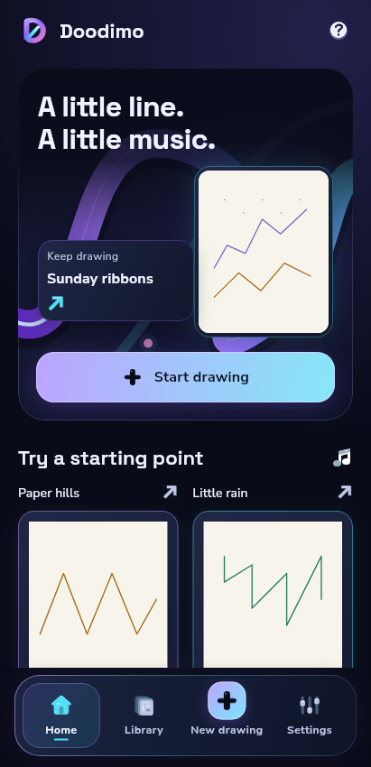
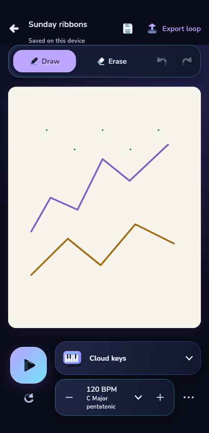
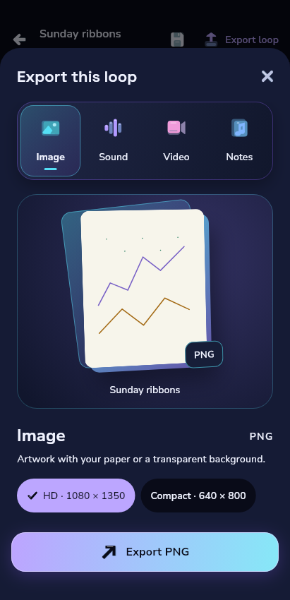

# Doodimo — first immersive implementation checkpoint

27 October 2026. Actual implemented Flutter widgets at 411 × 850 in dark mode, with bundled Space Grotesk/Nunito/Noto and newly authored filled duotone icons. These deterministic reduced-motion stills use declared repository/audio fixtures; they are not mockups, emulator screenshots, a real audio demonstration or design acceptance.

| Home — ribbon scene and luminous dock | Editor — stable artwork and split launch deck | Export — real frozen output stage |
|---|---|---|
|  |  |  |

This replaces both rejected warm/forest directions. Source includes the bounded animated ribbon/highlight/orbits, short scene reveal, moving dock selection, tactile presses, new dimensional D mark, integrated instrument controls and genuine export job states. Scene graphics never enter saved artwork or document exports. The paper shown belongs to the fixture document and is deliberately preserved independently of chrome.

An exact-source owned-emulator capture follows this checkpoint, including an18-second actual Home motion clip plus navigation, instrument/Play and export interactions. A PNG cannot establish the immersive motion requirement. The capture request records the complete product commit separately from diagnostic harness provenance.

Executed checks for the new slice include formatter/analyzer, direct Aurora lifecycle and rendered loop-continuity regressions, fresh-dark/saved-light persistence, semantic contrast/adaptive-panel tests, editor dark/light responsiveness, actual PNG publication/finalization/error/cancel and icon optics/semantics. The broader final-source product/native/runtime gate, remaining surfaces, complete visual/reduced-motion matrix and measured performance are still pending. Previous289-test/build success belongs to the rejected source checkpoint9d71f43 and is not reused as proof of this source.

The original main-bound full Android workflow is retained while this stacked prototype uses its dedicated capture/build/signature job. Enable the full stacked-branch CI gate at integration and execute `bash scripts/check-android.sh` against the final source before completion; old rejected pixel references are not design approval. All PRs remain draft/unmerged. No stores, remote runtime assets, accounts or paid services; physical and Mac/iOS acceptance remain separate.
