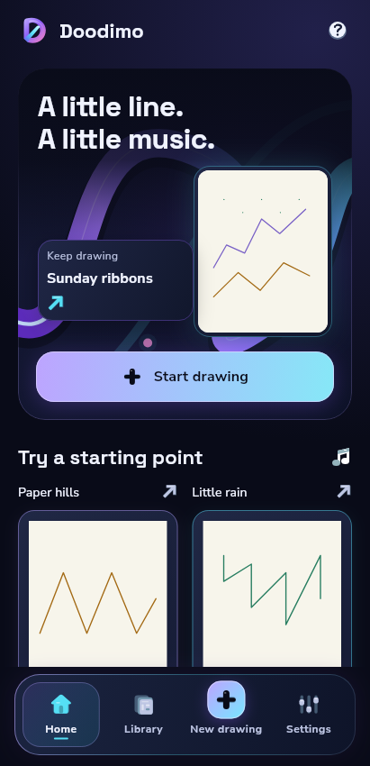
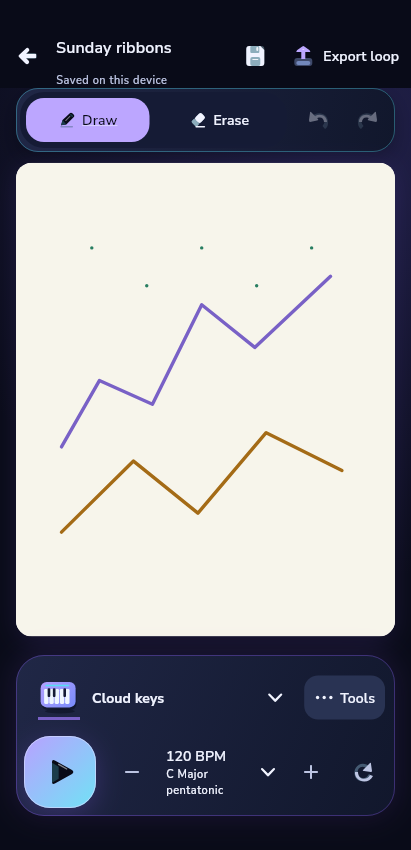
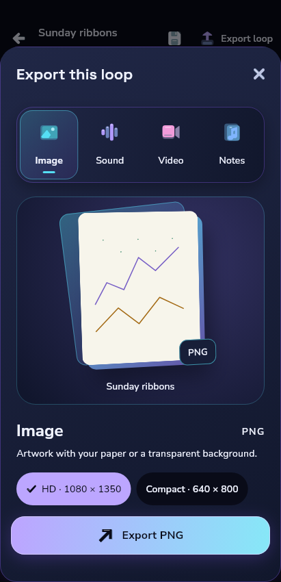
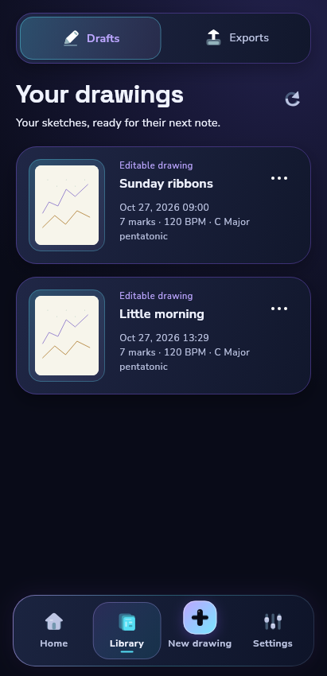
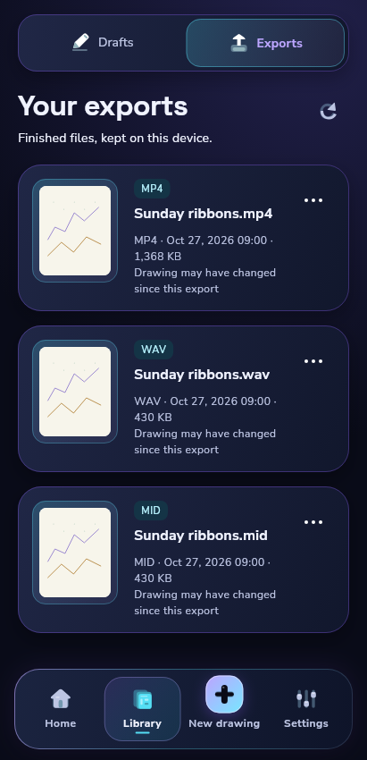
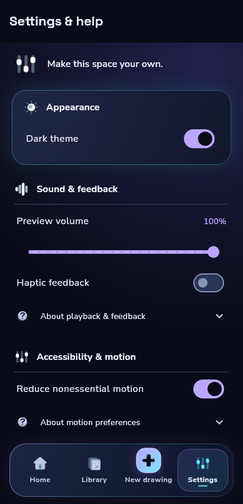
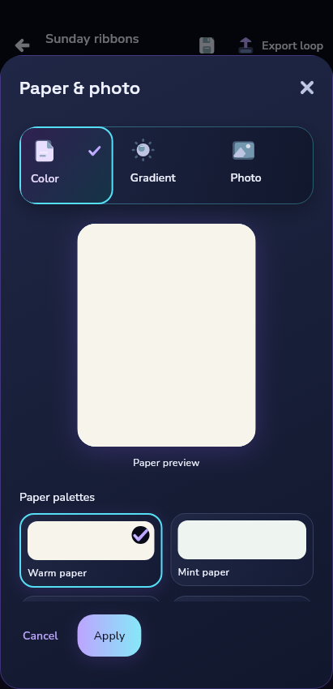
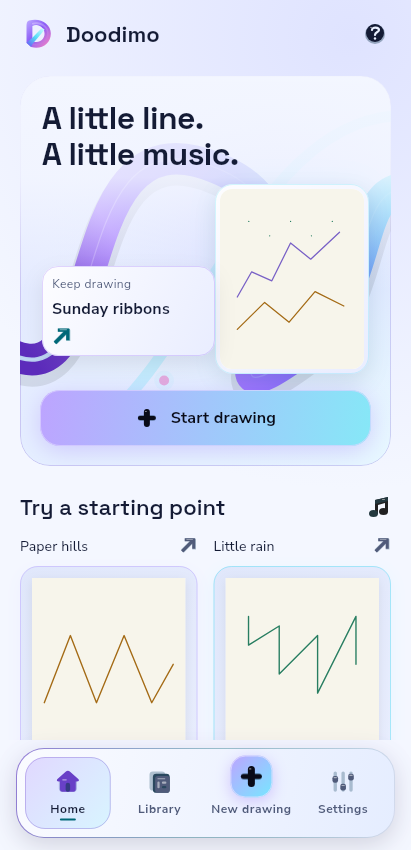
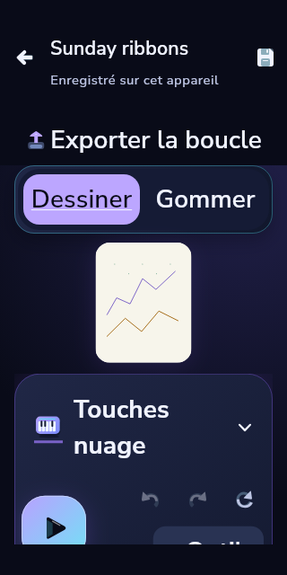

# Doodimo implemented screen review

27 October 2026. Product source `73bb548a221a4b1626e2516f5958d0141043c4ae`. These are actual Flutter widget renders with bundled fonts and
original assets, selected from a clean 76-state matrix. They use declared
repository/audio fixtures and reduced motion for deterministic pixels. They are
not mockups, native audio demonstrations or proof of runtime smoothness.

The subsequent bounded static-art cache preserves this composition. Its complete
local gate at shipping app f9fc4ba / capture-only harness efcac58 passed356Flutter tests and rerendered76states against the same eight
strict references, without regenerating them. Enabled-motion cache continuity
and resource lifetime have separate tests; native performance and IME evidence
remain tied to their exact cloud capture source, as recorded in DEVELOPMENT-STATUS.

| Home | Editor | Export |
|---|---|---|
|  |  |  |

| Drafts | Exports | Settings |
|---|---|---|
|  |  |  |

| Background editing | Cool light theme | Compact French 200% |
|---|---|---|
|  |  |  |

[Landscape editor](landscape-editor.png) · [Large-text RTL language selection](language-large-rtl.png) · [Large-text coach](coach-large.png).

The large-text editor uses scrolling controls rather than shrinking labels or
hit targets. At 200%, the coach prioritizes readable tip text and reachable
Skip/Next within a large scrolling card; the complete highlighted drawing is
not simultaneously visible. Language choices now appear before optional help.
Keyboard captures in the full matrix simulate insets; they do not show a native
system IME. The manifest records every fixture's size, scale and theme.

The original before captures remain in ../before. Both rejected visual sets are
historical, not accepted design references. Eight inspected immersive pixel
references now guard representative dark/light/compact/RTL layouts. Actual
cloud emulator recordings, measured profile timings, final-source product gates
and downloadable APK evidence remain independently required; see the current
DEVELOPMENT-STATUS and draft PR #23 for their exact-source status.
