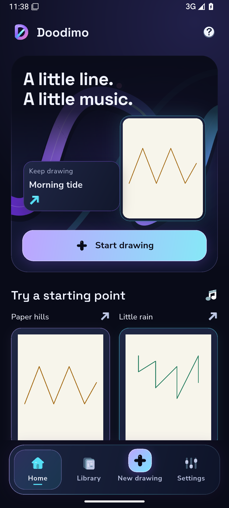

# Rejected cache layer performance trial

This original native PNG belongs to experimental product `2bd12e0`, harness `050e2b4`, [capture40602389730](https://github.com/Imran-shisheo/DrawMusic/actions/runs/40602389730), [artifact12780475490](https://github.com/Imran-shisheo/DrawMusic/actions/runs/40602389730/artifacts/12780475490). Reader40604030745 independently verified the PNG hash/bytes and completely decoded the unchanged39.860867-second/199-frame ambient recording. The experimental layer is rolled back; this is not the chosen application source or a smoothness pass. The original immersive composition and contrast fix are retained in the selected app.

| Actual observation | Result |
|---|---|
| Unrecorded interval | 17.952489seconds,111engine frames,34real clock/cache/lifecycle samples |
| UI p95 / raster p95 | 4.376ms /183.802ms |
| Raster over16.67ms | 111of111observed work durations; not an inferred display-drop count |
| Native whole-process PSS before / after | 173801 /181433KB; not peak or attributable change |
| Android HWUI | Zero observed frames and4950ms sentinel percentiles; cannot establish Flutter presentation pacing |
| Renderer | Impeller/OpenGLES, configured SwiftShader emulator |
| Video | Original H.264720×1600,39.860867s,199decoded frames; no padding, repeat or retiming |

The earlier fixed-order same-run diagnostic measured gradient raster p95/median189.470/166.287ms versus solid149.772/134.577ms. That implicates some composition cost, but the small cross-run difference to this candidate does not verify an optimization. Its extra layer/painter lifecycle is rejected. UI-PERF-01 remains unresolved; neither footage integrity nor encoded export FPS establishes a responsive physical display. Fixtures are original test projects, not real user activity. PNG bytes are unchanged; manifest.json records their digest.
