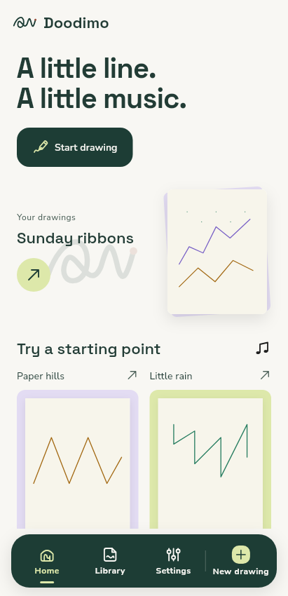
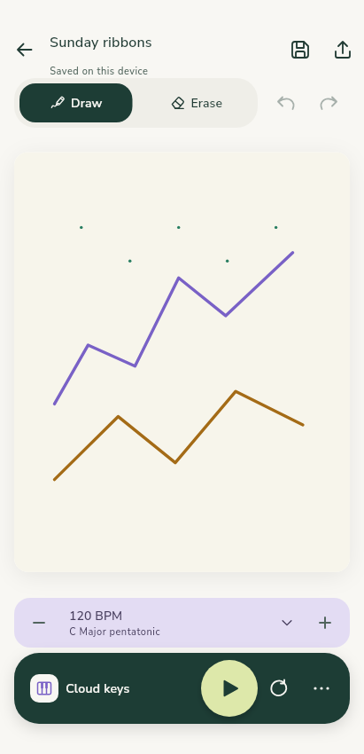
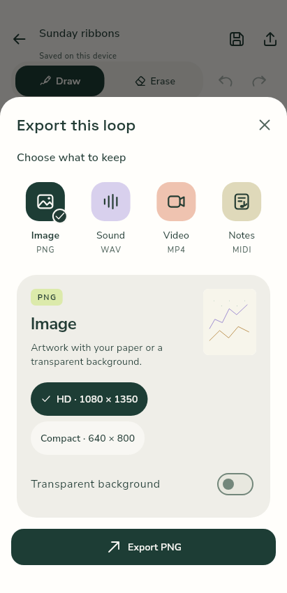

# Rejected second UI iteration — retained for comparison

The owner rejected this second iteration as still too basic and explicitly rejected its palette and icons. It is historical evidence, not the active aesthetic or accepted design. The active replacement is the immersive audiovisual-playground brief.

27 October 2026. Actual implemented Flutter widgets at 411 × 850, light theme, normal text. Bundled Space Grotesk display type, Nunito UI text and original vector glyphs are loaded. Repository/audio fixtures are declared in the manifest; these are deterministic reduced-motion stills, not emulator screenshots or native-audio/performance acceptance.

This revision replaces the rejected pale-card composition with an open real-artwork Home, paper sleeves, a compact four-key studio dock, joined editor tools and forest/lime transport console, plus a connected format rail and focused export workspace. The previous iteration remains [marked rejected](../progress/README.md) for comparison.

| Home — real saved artwork and studio dock | Editor — paper and tactile console | Export — format rail and selected output |
|---|---|---|
|  |  |  |

This is a reviewable work-in-progress proposal. Compact/large-text/dark/RTL/tablet and keyboard refinement, final-source functional tests/builds, actual emulator motion recordings and measured profile acceptance remain in progress. Disabled Undo/Redo in the fixture represent an initial document with no edit history. All saved artwork, synthesis, free features and package identity are preserved.
