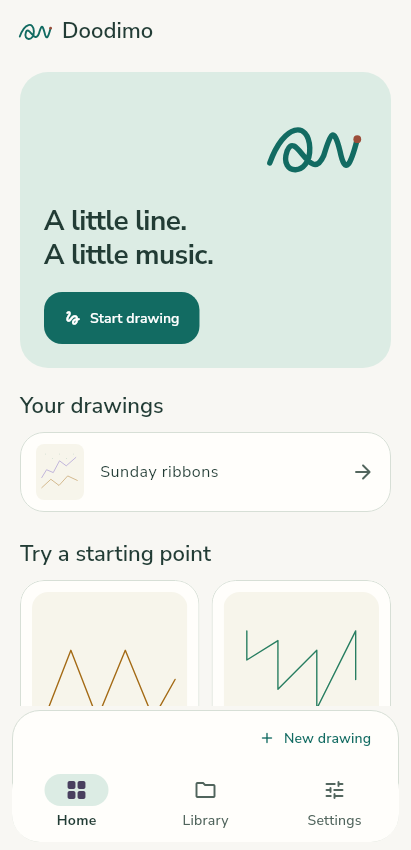
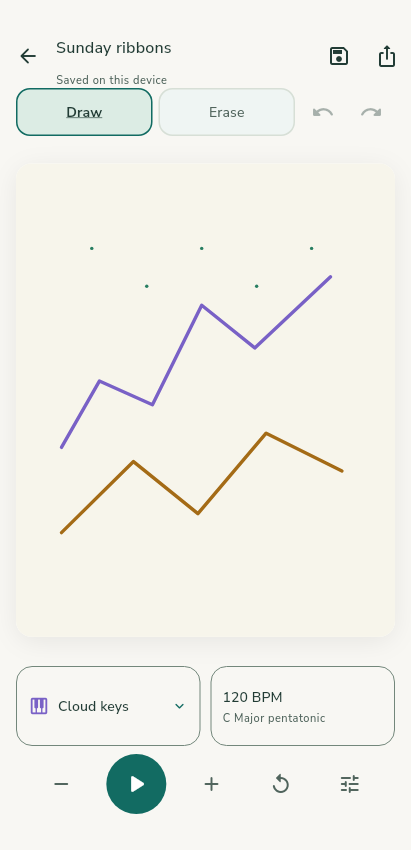
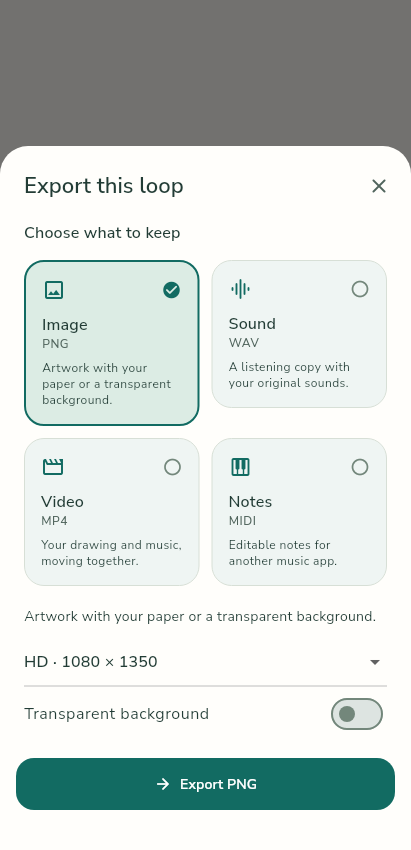

# Doodimo redesign — work-in-progress preview

27 October 2026. Actual Flutter product widgets rendered with bundled fonts and declared fixture storage/audio. These are implementation previews, not mockups, emulator screenshots, native-audio proof or final acceptance. Motion is frozen using the real reduced-motion preference for deterministic stills. All final-source functional, full visual and runtime/profile checks remain required; compact French layout and other refinements are still being checked.

| Home | Editor | Export |
|---|---|---|
|  |  |  |

The app name Doodimo was selected by the owner. The identifier and saved artwork are unchanged. Final launcher and other surfaces are being integrated. See [redesign acceptance ledger](../../UI-UX-REDESIGN.md).
