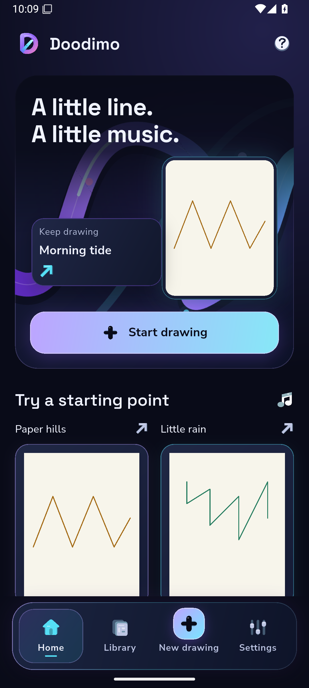
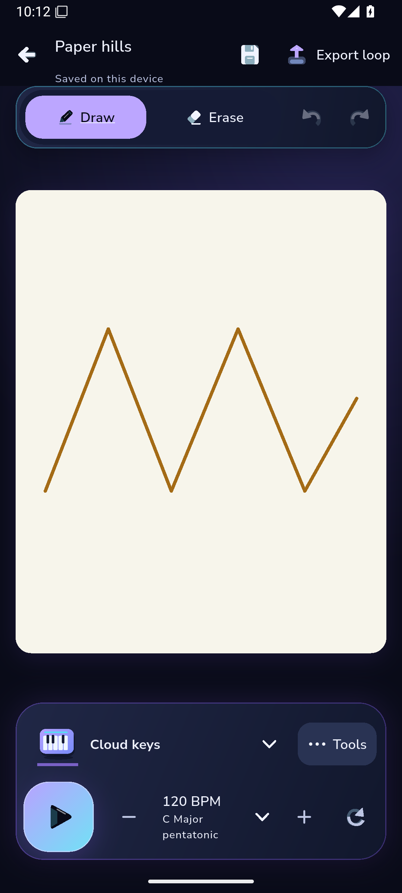
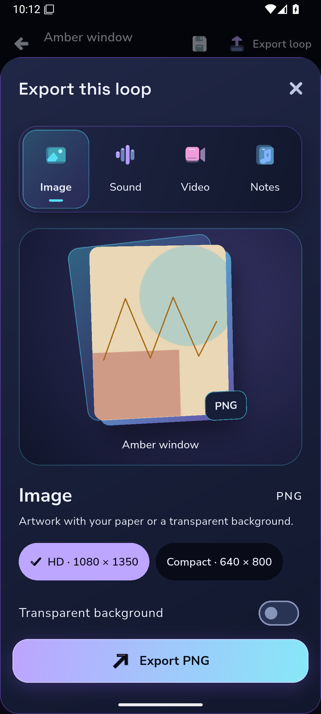

# Doodimo actual native checkpoint

27 October2026. These are original ADB screenshots of the implemented Android profile app, with bundled fonts and original assets. Product source `f9fc4ba`, diagnostic harness `5c4a7be`, [capture40560035660 attempt3](https://github.com/Imran-shisheo/DrawMusic/actions/runs/40560035660), [artifact12775775164](https://github.com/Imran-shisheo/DrawMusic/actions/runs/40560035660/artifacts/12775775164). Independent reader40594654948 checked each file against original host progress-manifest SHA and byte count. The files are copied without resizing or regeneration; manifest.json records exact hashes.

| Home | Editor | Export selection |
|---|---|---|
|  |  |  |

The projects and original paper illustration are declared capture fixtures, not real user activity. These English dark-theme screenshots use the actual1080×2400/420dpi owned API35 emulator. Document paper remains independent of the chrome.

This was a PARTIAL capture:17snapshots, seven actual recording pairs and three profile phases completed before VM/ADB transport disappeared during live compact-display reconfiguration. The original progress manifest says passed:false. Missing compact/tablet/cool-light evidence is being recovered separately. Snapshot10 genuinely shows the export selector, preview, size and transparency controls. Other diagnostic snapshots verify native focus/inset/panel geometry but do not show keyboard keys.

The40.580256-second/174-frame ambient recording fully decoded independently; it is silent. Actual unrecorded Home raster p95 was234.942ms, above the16.67ms budget. Stills and encoded video duration do not prove smoothness, audible audio, physical-device performance or iOS behavior. The full accepted app/native creation/export/recovery evidence remains linked in DEVELOPMENT-STATUS.md. This checkpoint is work in progress, not final redesign acceptance.
