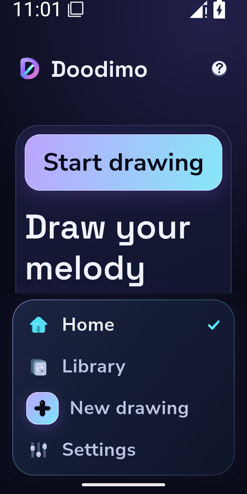
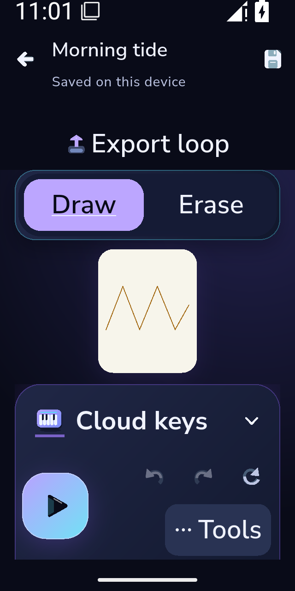

# Actual compact and large text capture

Original native PNGs from successful two-shot subset [40597917801](https://github.com/Imran-shisheo/DrawMusic/actions/runs/40597917801), [artifact12777104697](https://github.com/Imran-shisheo/DrawMusic/actions/runs/40597917801/artifacts/12777104697), independently hash/byte verified by reader40599296606. Productf9fc4ba, harness2fcfea0. The fresh owned API35 emulator was configured before app launch:640×1280physical pixels,320dpi,320×640logical dp, system text scale2.0. Platform and MediaQuery both reported2.0; actual font samples10/12/14/16 scale to20/24/28/32. The screenshot fences join the expected rendered routes to actual engine raster frames277/538.

| Home at200% | Editor at200% |
|---|---|
|  |  |

Pixel review: primary Start Drawing, all four navigation labels, project identity, Export, Draw/Erase, voice and transport remain readable. Navigation reflows vertically and occupies substantial height; Home's artwork/templates require scrolling. The editor preserves its4:5paper independently of the chrome, with a smaller visible canvas and scrollable console at this extreme size. Simultaneous visibility of every control is not claimed. The capture checks real route/scale/raster readiness; it is not a physical accessibility audit or a full23-shot/motion/performance pass. Original fixtures are declared test documents, not user activity. PNG bytes are copied unchanged; manifest.json records hashes.
