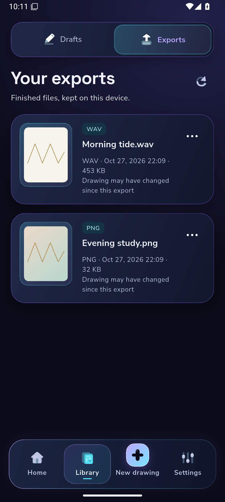
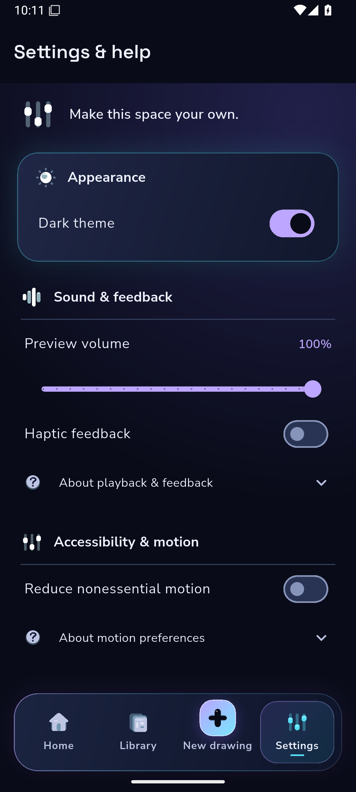
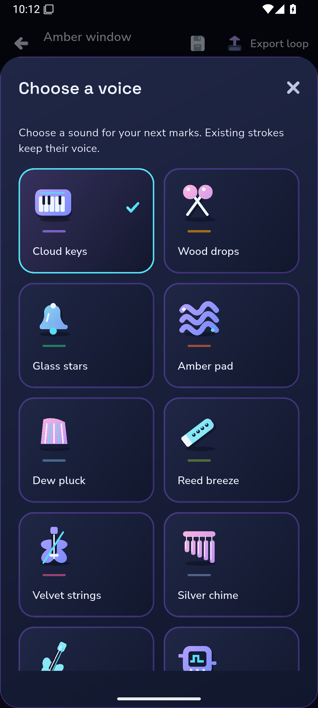
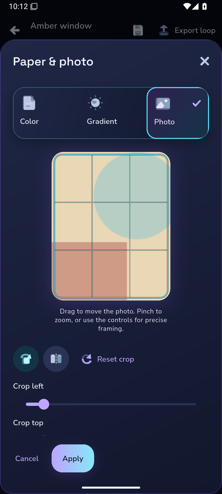
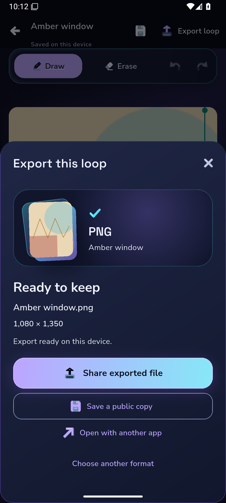
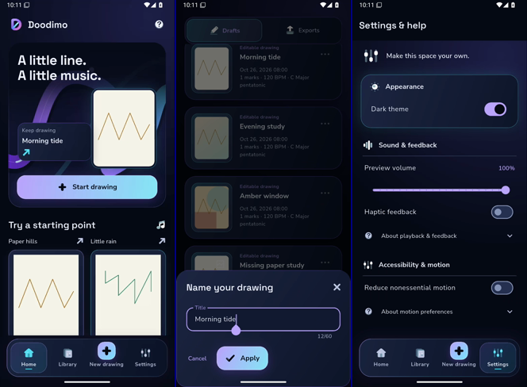
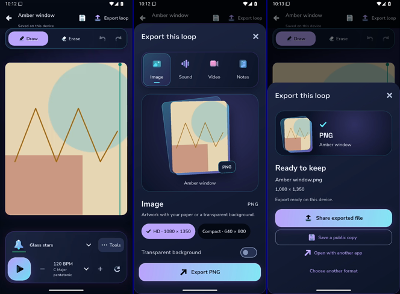

# Native panels and original interaction frames

These are original, unmodified Android PNGs from partial capture [40560035660 attempt3](https://github.com/Imran-shisheo/DrawMusic/actions/runs/40560035660), product `f9fc4ba`, harness `5c4a7be`. Independent reader [40605481897](https://github.com/Imran-shisheo/DrawMusic/actions/runs/40605481897) checked original SHA/bytes and fully decoded all six interaction clips. Manifest retains exact image digests. Original capture `passed:false` remains authoritative; these files do not turn it into a full-pass capture or validate the later missing-photo contrast correction.

| Exports | Settings | Instruments |
|---|---|---|
|  |  |  |

| Photo crop | Published PNG |
|---|---|
|  |  |

The crop preview retains the4:5 document aspect and transactional Cancel/Apply. Ready shows the actual1080×1350PNG and publication actions. Scrolling panels continue below the viewport. Settings/voice rows are not claimed to all fit simultaneously.

## Actual recordings

Download [original recordings and capture evidence12775775164](https://github.com/Imran-shisheo/DrawMusic/actions/runs/40560035660/artifacts/12775775164), retained through3November2026. They are silent, source-labelled emulator screen recordings, without padding, repetition or retiming:

| Original clip | Actual duration | Decoded frames |
|---|---:|---:|
| Ambient Home |40.580256s|174|
|01-root-navigation|31.177878s|117|
|02-home-editor-back|8.262700s|41|
|03-paper-sheet|12.060967s|44|
|04-instrument-and-playback|16.394811s|66|
|05-export-ready|16.806500s|55|
|06-reduced-motion|5.172956s|28|

The following diagnostic contacts select actual first/middle/last decoded frames. Navigation uses indices0/58/116 atPTS0/15.4962/30.9893seconds; export uses0/27/54 atPTS0/5.87756/16.1452. Contacts are separate from artwork and original videos, and cannot demonstrate smooth motion.

Pixel review found the transparency control reachable in the original export flow and document background present in its real ready thumbnail. Recorded Play/pause demonstrates state interaction, not captured audibility. Rendering performance remains over budget; see UI-PERF-01 in DEVELOPMENT-STATUS.md. These images are runtime evidence, not shipping art or fake user activity.
