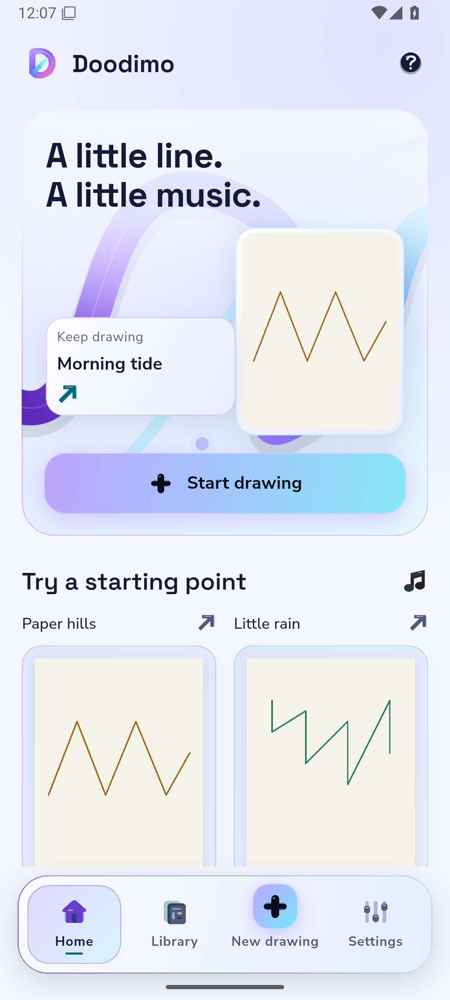
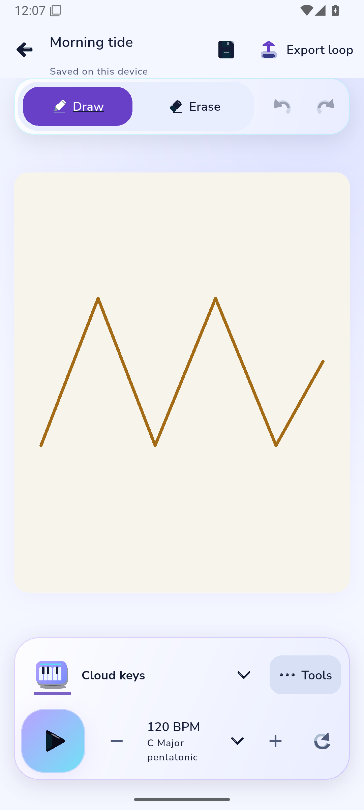

# Final chosen-source cool-light Android pixels

Original unmodified ADB PNGs from [capture40605481853](https://github.com/Imran-shisheo/DrawMusic/actions/runs/40605481853), chosen product `979c59657f8c0b3656f02f91cb572fda63176392`, harness `3bca6ae4f34beaff936f26df5e08a37e2e12b69f`. [Artifact12781300465](https://github.com/Imran-shisheo/DrawMusic/actions/runs/40605481853/artifacts/12781300465), ZIP SHA256 `d87606f7e4faf55dcaa5b5072858e69457a7169d86b147a99ac3dd0cd5b7a8e8`. Independent reader40606941645 verified original SHA/byte counts; manifest.json retains exact per-image values.

| Home | Drawn editor |
|---|---|
|  |  |

Owned API35 emulator, actual1080×2400/420dpi,411.43logical width, system and MediaQuery scale1.0 with actual font-size samples matching. The persisted light preference was applied before capture. Exact real scene/raster frame matches464/841 were required. Pixel review confirms readable title/Start/navigation/template labels, dark system icons against pale chrome, stable4:5canvas, readable named instrument/music controls and paper independent of app theme. Fixture projects are original declared test data, not invented user activity. Disabled Undo/Redo are intentionally subdued.

This is an explicitly complete **two-shot light subset**, not a full23-shot/performance/audio/physical-device/iOS pass. No recording/profile was requested in this subset; missing profile-resource files are reported as unavailable rather than zeros.

The same run built and v2-verified a **normal lib/main.dart APK**, [artifact12781655455](https://github.com/Imran-shisheo/DrawMusic/actions/runs/40605481853/artifacts/12781655455). It is separate from the diagnostic profile app. Product979c596 matches accepted B5protected production inputs exactly; current-core verification remains separately tracked. Both artifacts expire4November2026. UI-PERF-01 remains open despite correct light pixels.
