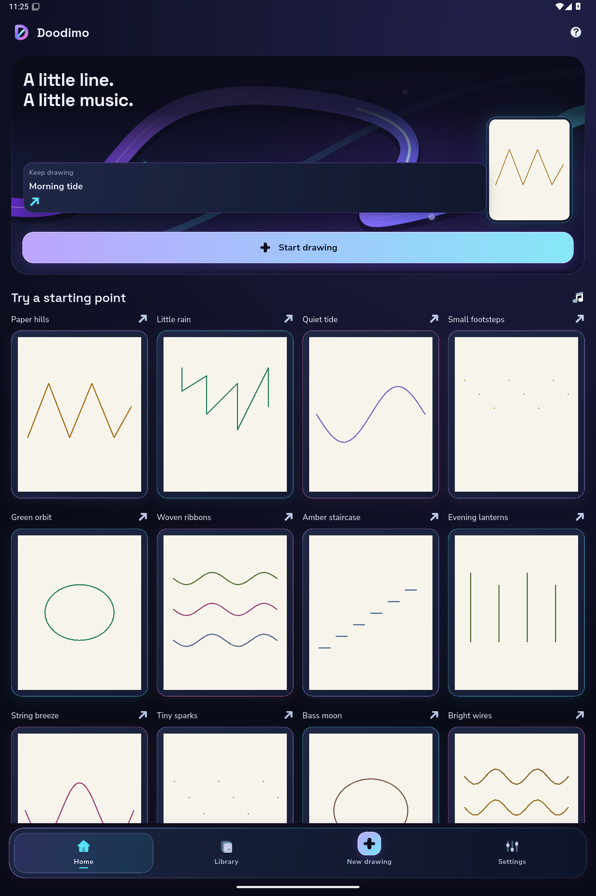
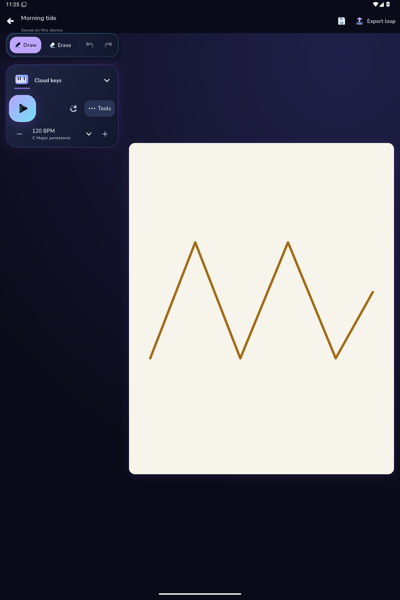

# Actual tablet capture

Original PNGs from successful subset [40600807250](https://github.com/Imran-shisheo/DrawMusic/actions/runs/40600807250), [artifact12779143072](https://github.com/Imran-shisheo/DrawMusic/actions/runs/40600807250/artifacts/12779143072). Reader40602389652 independently verified original hashes and byte counts. Product9af0d6f, harnessa0b0e4b; fresh owned API35 emulator,1600×2400physical pixels at240dpi, approximately1067×1600logical dp and system text scale1.0. Fixture projects are declared original test data, not user activity.

| Home | Editor |
|---|---|
|  |  |

Pixel review: real template names/artwork remain distinct, the primary action and labeled dock are visible, and the wide editor places named tools/transport beside a dominant4:5canvas. The gallery continues by scrolling; simultaneous visibility of all20templates is not claimed. Original screenshot bytes are unchanged. This is a two-shot responsive subset, not complete23-shot, animation-performance, physical-tablet, screen-reader or iOS acceptance. It predates the later static-lighting cache hint; the source remains explicitly identified.
